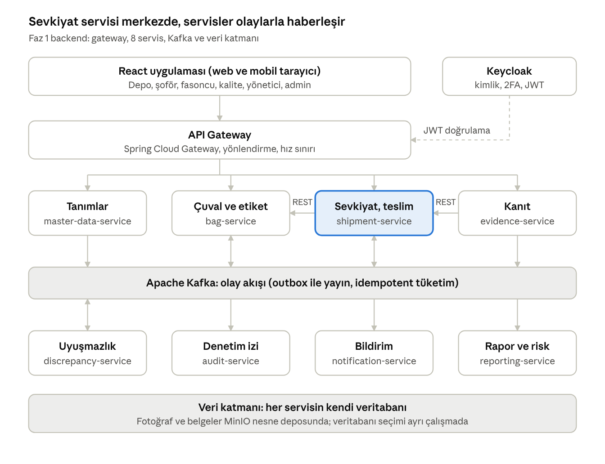

# İplik Sevkiyat Sistemi – Java Mikroservis Mimarisi

> Sürüm 1.0 · 20.10.2026 · Kaynak: Ön analiz raporu v1.1 · Canlı doküman: [Claude Docs](https://claude.ai/code/artifact/b3dbda92-562a-4125-a8e8-5d4812fd2607)

## Özet ve temel kararlar

Backend, iş alanına göre ayrılmış 8 Spring Boot servisinden, önlerinde tek bir API Gateway'den ve servisler arası olayları taşıyan bir mesaj kuyruğundan oluşur. Ön analiz v1.1'deki modüller (Bölüm 4.1 ve 17.1) bu servislere birebir dağıtılmıştır; kör giriş, kayıt kilidi ve audit log gibi hile önleme kuralları servis sınırlarıyla korunur.

| Konu                | Karar                                                       | Kısa gerekçe                                                                         |
|---------------------|-------------------------------------------------------------|--------------------------------------------------------------------------------------|
| Mimari              | Alan bazlı mikroservis, 8 iş servisi + gateway              | Modüller birbirinden net ayrılıyor; kanıt ve audit gibi hassas alanlar izole kalıyor |
| Dil ve çatı         | Java 25 LTS, Spring Boot 4.x, Spring Cloud                  | Ekip Java yazacak; Spring en olgun ve en çok destek bulunan ekosistem                |
| Senkron iletişim    | REST + JSON (OpenAPI 3), Spring RestClient / HTTP Interface | Anında cevap gereken az sayıdaki çağrı için basit ve izlenebilir                     |
| Asenkron iletişim   | Apache Kafka (KRaft), transactional outbox                  | Olaylar kalıcı ve tekrar oynatılabilir; audit ve raporlama aynı akıştan beslenir     |
| Süreç koordinasyonu | Olay tabanlı koreografi (saga)                              | Sevkiyat akışı adım adım ilerliyor; merkezi orkestratöre gerek yok                   |
| API Gateway         | Spring Cloud Gateway                                        | Tek giriş noktası, JWT doğrulama, hız sınırı, CORS                                   |
| Service discovery   | Kubernetes Service DNS (Eureka yok)                         | Platform zaten sağlıyor; ek bileşen işletmeye gerek yok                              |
| Konfigürasyon       | Kubernetes ConfigMap/Secret + Spring profilleri             | Ortam bazlı ayar tek yerde; Config Server yalnızca K8s dışı kurulumda                |
| Kimlik              | Keycloak (OIDC/JWT)                                         | Giriş gateway'de BFF oturumu ile; kullanıcısız işler için servis başına SYSTEM rollü client credentials (PR #4)                                         |
| Dosyalar            | S3 uyumlu nesne deposu (MinIO)                              | Fotoğraf ve belgeler veritabanına değil nesne deposuna yazılır                       |

Veritabanı seçimi, yetki modeli ve React frontend ayrı çalışmalarda ele alınıyor; bu doküman onlarla kesiştiği yerleri yalnızca arayüz düzeyinde tanımlar.

## Mimari yaklaşım

Mikroservis tercih edildi, ancak servis sayısı sistemin ölçeğine göre bilinçli olarak küçük tutuldu. Faz 1'de tek fabrika ve 1–2 pilot fasoncu var; yük düşük, asıl ihtiyaç güvenilirlik ve kanıt bütünlüğü.

Mikroservisin bu projede sağladığı somut faydalar:

- **Kanıt ve audit izolasyonu:** Fotoğraf, hash ve audit kayıtları ayrı servislerde ve ayrı veritabanlarında durur. Sevkiyat servisinde yetki açığı olsa bile kanıt silinemez, audit değiştirilemez.

- **Kör girişin teknik garantisi:** Çıkış kilosu ile teslim kilosunu yan yana gören tek yer karşılaştırma servisidir. Fasoncuya dönen API bu veriyi hiç taşımaz.

- **Bağımsız ölçekleme:** Fotoğraf yükleme (sevkiyat başına 10–15 dosya) diğer işlemlerden çok daha fazla kaynak tüketir ve tek başına ölçeklenebilir.

- **Faz 2 ve 3'e hazırlık:** e-İrsaliye, ERP, kantar, GPS ve RFID entegrasyonları yeni servisler olarak eklenir, mevcut servislere dokunulmaz.

Bedeli: dağıtık sistem işletmesi (Kafka, Kubernetes, izleme) ve servisler arası tutarlılığın olaylarla sağlanması. Bu yükü azaltmak için tüm servisler tek repoda, ortak kütüphanelerle ve aynı şablonla yazılır. Ekip 3 kişiden fazla olduğu için Faz 1'e doğrudan mikroservislerle başlanır; servisler ekip üyeleri arasında paylaştırılabilir.

## Servis sınırları

Her servis kendi verisinin tek sahibidir; başka bir servisin tablosuna doğrudan erişmez, yalnızca API'si veya olayları üzerinden konuşur. Faz sütunu, ön analizin Bölüm 17 yol haritasına göre verilmiştir.



Üst sıradaki servisler kullanıcı işlemlerini alır ve olay yayınlar; alt sıradakiler bu olaylarla çalışır. Gateway, uyuşmazlık kararı ve raporlar için alt sıradaki servislerin API'lerine de yönlendirir; şemada sadeleştirmek için bu oklar gösterilmedi.

| Servis                                            | Sorumluluk                                                                                                                                  | Sahip olduğu veri                                                       | Yayınladığı başlıca olaylar                                                                      | Faz             |
|---------------------------------------------------|---------------------------------------------------------------------------------------------------------------------------------------------|-------------------------------------------------------------------------|--------------------------------------------------------------------------------------------------|-----------------|
| master-data-service (Tanımlar)                    | Lokasyon (fabrika/depo), fasoncu, şoför, araç, iplik/ürün, parti ve kalite tanımları; partinin kalite kilidi; standart dara değerleri                                | Lokasyon (Site), Fasoncu, Şoför, Araç, Ürün, Parti, KaliteSınıfı, DaraStandardı          | LotQualityLocked, SubcontractorUpdated, DriverUpdated                                    | 1               |
| bag-service (Çuval ve etiket)                     | Unique Key üretimi, etiket basımı (QR/barkod), çuval–parti bağı, anahtarın tek kullanım garantisi                                           | Çuval, EtiketBaskısı, ÇuvalRezervasyonu                                 | BagCreated, BagAssignedToShipment, BagReservationReleased                             | 1               |
| shipment-service (Sevkiyat ve teslimat)           | Sevkiyat oluşturma, şoför/araç atama, çıkış tartımı, mühür, şoför beyanları, fasoncu kör teslim girişi, durum makinesi ve kilitleme         | Sevkiyat, ÇıkışTartımı, Mühür, ŞoförBeyanı, TeslimGirişi, DüzeltmeKaydı | ShipmentLoaded, ShipmentDispatched, DeliveryReceived, ShipmentCompleted, ShipmentLocked | 1               |
| evidence-service (Kanıt)                          | Fotoğraf ve imzalı belge yükleme, SHA-256 hash, sunucu zaman damgası, tekrar kullanım tespiti, filigran, "geçersiz" işaretleme (silme yok)  | KanıtDosyası (meta veri), dosyanın kendisi nesne deposunda              | EvidenceUploaded, EvidenceInvalidated, EvidenceReuseDetected                            | 1               |
| discrepancy-service (Karşılaştırma ve uyuşmazlık) | Otomatik karşılaştırma (net kilo, çuval listesi, mühür, belge, zaman), tolerans bantları, uyuşmazlık yaşam döngüsü, kalite itirazı ve karar | Uyuşmazlık, KaliteItirazı, Karar, ToleransKuralı                        | ComparisonCompleted, DiscrepancyOpened, DiscrepancyResolved                               | 1               |
| audit-service (Denetim izi)                       | Tüm servislerin olaylarını ve değişiklik kayıtlarını sadece-ekle (append-only) olarak saklar; kayıtlar hash zinciriyle birbirine bağlanır   | AuditKaydı                                                              | (tüketici, olay yayınlamaz)                                                                      | 1               |
| notification-service (Bildirim)                   | Kırmızı uyuşmazlık, süresi geçen inceleme ve eksik belge için e-posta ve uygulama içi bildirim                                              | Bildirim, BildirimTercihi                                               | NotificationSent                                                                               | 1               |
| reporting-service (Rapor ve risk)                 | Dashboard, şoför/fasoncu/eşleşme bazlı göstergeler; Faz 2'de risk skoru ve rastgele kontrol seçimi                                          | Okuma modelleri (olaylardan türetilir)                                  | ShipmentSelectedForInspection (Faz 2)                                                                       | 1 temel, 2 risk |

**Geçici durum (master-data okuma uçları):** master-data-service henüz yoktur. Sevkiyat ekranlarının ihtiyacı olan salt okunur liste uçları (`GET /api/v1/master-data/subcontractors|drivers|vehicles|sites`, izin `MASTER_DATA_VIEW`) şimdilik shipment-service içinde, kendi paketinde (`masterdata`) ve kendi OpenAPI etiketiyle (`MasterData`) durur. Yol ve sözleşme master-data-service'e taşınırken değişmez; gateway'de yalnızca `/api/v1/master-data/**` rotasının hedefi değiştirilir. Bu uçlar sevkiyat tablolarına dokunmaz; servis taşındığında yalnızca paket ve ilgili migration'lar taşınır.

Kimlik doğrulama Keycloak tarafından yapılır ve ayrı bir Java servisi yazılmaz; kullanıcı–fasoncu ilişkisi gibi iş kuralları yetkilendirme çalışmasının sonucuna göre master-data-service içinde ya da küçük bir user-service olarak tutulacaktır.

**Çok lokasyon:** Faz 1'de tek fabrika olsa da lokasyona bağlı her kayıt (sevkiyat, çuval, parti, dara standardı) bir `SiteId` taşır. Yeni fabrika veya depo eklendiğinde servis sınırları ve şemalar değişmez; sorgular ve yetki kontrolleri `SiteId`'yi her zaman hesaba katar.

**Sonraki fazlarda eklenecek servisler:** integration-service (e-İrsaliye, e-Fatura, ERP; Faz 2) ve device-gateway-service (kantar, GPS, RFID, elektronik mühür; Faz 3). İkisi de mevcut olayları tüketir ve yeni olay üretir; çekirdek servislerin kodu değişmez.

## Servisler arası iletişim

Kural basit: kullanıcı bir cevap bekliyorsa ve sonuç hemen gerekiyorsa REST, bir şey olduğunu diğer servislere duyurmak gerekiyorsa Kafka olayı kullanılır. Servisler arası senkron çağrı sayısı bilinçli olarak üçle sınırlıdır.

### Senkron çağrılar (REST)

| Çağıran          | Çağrılan            | Amaç                                                                                  | Neden senkron                                                         |
|------------------|---------------------|---------------------------------------------------------------------------------------|-----------------------------------------------------------------------|
| shipment-service | bag-service         | Okutulan Unique Key'leri sevkiyata rezerve etmek, parti ve kaliteyi almak             | Anahtar başka sevkiyattaysa depo personeli bunu okuttuğu anda görmeli |
| shipment-service | master-data-service | Sevkiyat oluştururken fasoncu, şoför ve araç geçerliliğini doğrulamak                 | Geçersiz kayıtla sevkiyat açılmamalı                                  |
| evidence-service | shipment-service    | Yükleme isteğinin ait olduğu sevkiyatın var olduğunu ve kilitli olmadığını doğrulamak | Kilitli sevkiyata kanıt eklenmemeli                                   |

Tüm senkron çağrılarda Resilience4j ile zaman aşımı (2 sn), sınırlı tekrar ve devre kesici kullanılır. Hata modeli RFC 9457 ProblemDetail formatındadır.

- **API-12** Servisler arası senkron çağrılar yalnızca mimari dokümanda listelenen üç çağrıdır. Yeni bir senkron çağrı eklemek ADR gerektirir. Servisler arası çağrılarda kullanıcının JWT'si iletilir; kullanıcısız işler (zamanlanmış görevler, olay tüketicilerinin yaptığı çağrılar) her servis için ayrı tanımlanan, SYSTEM rolü taşıyan client credentials client'ıyla token alır.

### Asenkron olaylar (Kafka)

- **Transactional outbox:** Servis, iş verisini ve olayı aynı veritabanı işlemiyle kendi outbox tablosuna yazar; ayrı bir yayıncı Kafka'ya iletir. Böylece "veri kaydedildi ama olay kayboldu" durumu oluşmaz. Faz 1'de yoklamalı (polling) yayıncı, hacim artarsa Debezium kullanılır.

- **Idempotent tüketici:** Her olayda benzersiz eventId bulunur; tüketici işlediği kimlikleri saklar ve tekrar gelen olayı yok sayar.

- **Sıralama:** Olaylar sevkiyat kimliğiyle (shipmentId) bölümlenir, böylece aynı sevkiyatın olayları sırayla işlenir.

- **Olay formatı:** JSON + CloudEvents zarfı (id, type, source, time, subject); başlıkta ayrıca aktorId, aktorRolleri ve korelasyonId taşınır, böylece her olayın kimin adına üretildiği audit kaydına girer. Olay adları İngilizce ve geçmiş zamandır (DeliveryReceived gibi); type alanı `com.yarnshipment.<alan>.<olay>.v1`, konu adları `<alan>.events.v1` biçimindedir. Türkçe karşılıklar bu dokümanın sonundaki olay kataloğundadır. Şemalar ortak event-contracts modülünde versiyonlanır.

- **Hatalı olaylar:** Tekrar denemelerden sonra işlenemeyen olay \*.DLT konusuna gider ve izleme panelinde alarm üretir.

#### Olay sözleşmesi kuralları

- **EVT-02** Zarf CloudEvents'tir (mimari doküman). Alanlar:

| Alan | Kural | Örnek |
| --- | --- | --- |
| `id` | UUIDv7, olay başına benzersiz; idempotency anahtarı | `0192b5d0-...` |
| `source` | `/yarn-shipment/<servis-adı>` | `/yarn-shipment/shipment-service` |
| `type` | `com.yarnshipment.<alan>.<olay-kebab>.v<n>` | `com.yarnshipment.shipment.delivery-received.v1` |
| `subject` | Bölümleme kimliği (çoğunlukla `shipmentId`) | `0192b5c1-...` |
| `time` | Olayın gerçekleştiği sunucu zamanı (UTC) | `2026-10-20T08:15:30Z` |
| `datacontenttype` | `application/json` | |
| `data` | Olay record'u | |

- **EVT-03 Transactional outbox zorunludur.** Olay, iş verisiyle aynı transaction'da `outbox_event` tablosuna yazılır; Kafka'ya `common-outbox` yayıncısı iletir. Servis kodu Kafka'ya doğrudan yazmaz (ARCH-07).
- **EVT-04 Konu adları** `<alan>.events.v<n>` biçimindedir: `shipment.events.v1`, `evidence.events.v1`, `discrepancy.events.v1`. Hatalı olay konusu `<konu>.DLT`. Mesaj anahtarı bölümleme kimliğidir (sevkiyat olaylarında `shipmentId`); aynı sevkiyatın olayları sıralı işlenir.
- **EVT-05 İdempotent tüketici zorunludur.** Her tüketici olayın `id`'sini `processed_event` tablosuna işlemle **aynı transaction**'da yazar. Unique ihlali "zaten işlendi" anlamına gelir ve olay sessizce onaylanır.
- **EVT-06 Şema evrimi.** Bir olay sürümüne yalnızca **isteğe bağlı yeni alan** eklenebilir. Alan silme, yeniden adlandırma, tip veya anlam değişikliği yeni sürüm (`.v2`) gerektirir; eski sürüm tüm tüketiciler geçene kadar paralel yayınlanır. Tüketiciler bilinmeyen alanları yok sayar (`FAIL_ON_UNKNOWN_PROPERTIES=false` yalnızca olay okuyucusunda).
- **EVT-09** Tüketici hata politikası: geçici hatalarda üstel bekleme ile en fazla 3 tekrar, sonra `.DLT`. Kalıcı hatalar (seri kaldırma, doğrulama) tekrar edilmeden doğrudan `.DLT`'ye gider. DLT'ye düşen her olay alarm üretir.

### Sevkiyat akışı (koreografi saga)

1.  Depo personeli çuvalları okutur; shipment-service, bag-service üzerinden anahtarları rezerve eder.

2.  Çıkış tartımı, mühür ve fotoğraflar girilir. evidence-service her dosya için EvidenceUploaded yayınlar; shipment-service zorunlu kanıtların tamamlandığını bu olaylardan izler ve durumu *Yüklendi* yapar.

3.  Şoför beyanlarıyla durum *Yolda* ve *Teslim Bekliyor* olur.

4.  Fasoncu kör teslim girişini yapar; shipment-service DeliveryReceived olayını çıkış ve teslim verisiyle birlikte yayınlar, durum *Kontrolde* olur.

5.  discrepancy-service karşılaştırmayı yapar ve ComparisonCompleted yayınlar: temizse sevkiyat *Tamamlandı* olup kilitlenir; uyuşmazlık varsa *İncelemede* olur ve notification-service Kırmızı bantta yetkiliye bildirim gönderir.

6.  Kalite yetkilisi karar verdikçe DiscrepancyResolved yayınlanır; son açık uyuşmazlık kapandığında sevkiyat *Tamamlandı* olur ve kilitlenir.

7.  audit-service ve reporting-service tüm bu olayları dinler; hiçbir servis onları beklemez.

Bir adımın geri alınması gerektiğinde (örneğin *İptal*) telafi olayı yayınlanır: ShipmentCancelled gelince bag-service rezervasyonları serbest bırakır.

**Kör giriş kuralı:** Çıkış kilosu ve çuval sayısı DeliveryReceived olayında yalnızca discrepancy-service'e gider. shipment-service'in fasoncuya ve şoföre dönen API yanıtları bu alanları karşılaştırma bitene kadar içermez; bu, ayrı DTO'larla ve sözleşme testleriyle güvence altına alınır.

- **SEC-06 Olay seviyesi.** Çıkış verisini taşıyan olaylar (`DeliveryReceived`) yalnızca discrepancy-service ve audit-service tarafından tüketilir. Bu iki servis dışında bu alanları bir API yanıtına koyan kod yazılmaz; Kafka ACL'leri buna göre tanımlanır.

## API Gateway, service discovery ve konfigürasyon

React uygulaması ve mobil tarayıcılar yalnızca gateway ile konuşur; servisler dışarıya kapalıdır.

### API Gateway: Spring Cloud Gateway

- **Yönlendirme:** /api/v1/shipments/\*\* → shipment-service, /api/v1/evidence/\*\* → evidence-service gibi yol bazlı kurallar.

- **Kimlik doğrulama:** Kullanıcı girişi gateway'de BFF oturumu ile yapılır: gateway Keycloak ile OIDC akışını yürütür, token'ları sunucu tarafında tutar ve tarayıcıya yalnızca HttpOnly oturum çerezi verir. Servislere giden isteklere JWT eklenir (token relay). Servisler de token'ı tekrar doğrular (sıfır güven); rol ve kapsam kontrolü servis içinde yapılır. **SEC-01** Her servis OAuth2 Resource Server olarak JWT'yi kendisi de doğrular (sıfır güven). Gateway'den geldi diye istek güvenilir sayılmaz.

- **Hız sınırı:** Redis tabanlı kullanıcı başına limit; özellikle giriş ve yükleme uçları için.

- **İzlenebilirlik:** Her isteğe traceparent ve X-Request-Id eklenir.

- **CORS ve güvenlik başlıkları** tek yerde yönetilir.

- **Büyük dosyalar gateway'den geçmez:** evidence-service kısa ömürlü (ör. 10 dk) imzalı yükleme adresi (pre-signed URL) verir, telefon dosyayı doğrudan nesne deposuna gönderir, ardından servis hash'i sunucuda yeniden hesaplayıp kaydı onaylar. Bu, zayıf bağlantıda yarım kalan yüklemelerin tekrar denenmesini de kolaylaştırır.

Gateway aynı zamanda frontend'in BFF katmanıdır; ayrı bir BFF servisi yazılmaz. Token tarayıcıda tutulmaz (yetkilendirme kararı, PR #4).

### Service discovery: Kubernetes DNS

Servisler Kubernetes üzerinde çalışır ve birbirini http://bag-service:8080 gibi Service adlarıyla bulur. Eureka veya Consul kurulmaz; yük dağıtımı ve sağlık kontrolü Kubernetes tarafından yapılır. İlk aşamada sistem yerel makinede Docker Compose ile çalışır; Compose ağı da aynı servis adlarını çözdüğü için Eureka yine gerekmez. Kendi sunucularınıza geçişte kod değişmez, yalnızca dağıtım dosyaları (Helm) devreye girer.

### Konfigürasyon

- Ortam ayarları (dev, test, prod) Spring profilleri ve Kubernetes ConfigMap ile verilir.

- Gizli bilgiler (veritabanı şifresi, Kafka ve MinIO anahtarları) Kubernetes Secret'ta, tercihen Vault veya Sealed Secrets ile tutulur; repoya girmez.

- **İş ayarları konfigürasyon değildir:** Tolerans bantları, zorunlu fotoğraf listesi, itiraz süresi ve rastgele kontrol oranı Admin ekranından değiştirilir. Bu yüzden ilgili servisin veritabanında, değişiklik geçmişiyle ve audit kaydıyla tutulur (CONF-04).

## Teknoloji yığını

Sürümler projenin başladığı günün güncel kararlı sürümleriyle kesinleştirilmelidir; aşağıdaki numaralar hafızadan verilmiş yaklaşık değerlerdir.

| Katman                 | Seçim                                                                               | Gerekçe                                                                                                       |
|------------------------|-------------------------------------------------------------------------------------|---------------------------------------------------------------------------------------------------------------|
| Dil                    | Java 25 LTS (Java 21 LTS yedek)                                                     | Uzun süreli destek; sanal thread'ler yüksek eşzamanlı G/Ç'yi basitleştirir                                    |
| Çatı                   | Spring Boot 4.x (Spring Framework 7)                                                | Olgun ekosistem, geniş geliştirici havuzu, Kafka/Keycloak/S3 entegrasyonları hazır                            |
| Bulut bileşenleri      | Spring Cloud (Gateway, Kubernetes, Stream veya Spring Kafka)                        | Gateway ve K8s entegrasyonu tek ekosistemden                                                                  |
| Web                    | Spring MVC + sanal thread'ler                                                       | Reaktif programlamanın karmaşıklığı olmadan yeterli ölçek                                                     |
| Veri erişimi           | Spring Data JPA (Hibernate), Flyway ile migration                                   | Standart, test edilmesi kolay; şema değişiklikleri versiyonlu                                                 |
| Veritabanı             | Servis başına ayrı şema veya veritabanı                                             | Kesin seçim veritabanı çalışmasında; bu mimari ilişkisel bir veritabanı varsayıyor                            |
| Mesajlaşma             | Apache Kafka (KRaft modu), Spring Kafka                                             | Kalıcı ve tekrar oynatılabilir olay akışı; audit ve raporlama yeniden inşa edilebilir                         |
| Nesne deposu           | MinIO (S3 uyumlu), AWS SDK v2                                                       | Kendi sunucunuzda çalışır; ileride buluta taşımak kod değiştirmez. Object Lock ile dosyalar silinemez yapılır |
| Önbellek ve hız sınırı | Redis                                                                               | Gateway rate limit ve kısa süreli önbellek                                                                    |
| Kimlik                 | Keycloak + Spring Security OAuth2 Resource Server                                   | Açık kaynak, iki adımlı doğrulama (Admin ve Kalite için) hazır                                                |
| API sözleşmesi         | OpenAPI 3 (springdoc), API-first                                                    | Frontend ekibi sözleşmeden TypeScript istemcisi üretebilir                                                    |
| Eşleme ve doğrulama    | MapStruct, Jakarta Bean Validation                                                  | Derleme zamanında güvenli DTO dönüşümü                                                                        |
| Dayanıklılık           | Resilience4j                                                                        | Zaman aşımı, tekrar, devre kesici                                                                             |
| Etiket ve belge        | ZXing (QR/barkod), OpenPDF veya JasperReports (etiket ve sevkiyat dosyası PDF)      | Açık kaynak, sunucu tarafında üretim                                                                          |
| Test                   | JUnit 5, Testcontainers (veritabanı, Kafka, MinIO), Spring Cloud Contract, ArchUnit | Gerçek altyapıyla entegrasyon testi; servisler arası sözleşme testi                                           |
| Derleme                | Maven (çok modüllü), Jib ile container imajı                                        | Dockerfile yazmadan tekrarlanabilir imaj                                                                      |

### Çalışma zamanı

- **CONC-01** Tüm servislerde `spring.threads.virtual.enabled=true`. Web istekleri, Kafka dinleyicileri ve `@Async`/zamanlanmış işler sanal thread'lerde çalışır. Kod bloklayan, düz, okunabilir G/Ç yazar.
- **CONC-02 Reaktif programlama kullanılmaz** (WebFlux, Reactor, RxJava). Tek istisna API Gateway'dir (karar D-3); reaktif kod yalnızca `platform/api-gateway` içinde kalır.
- **BUILD-07** Container imajı Jib ile üretilir; temel imaj Eclipse Temurin 25 JRE'dir. JVM parametreleri: `-XX:MaxRAMPercentage=75 -XX:+UseCompactObjectHeaders -XX:+ExitOnOutOfMemoryError` ve NAME-10'daki yerel ayarlar. Çöp toplayıcı varsayılan G1'dir; değiştirmek ölçüm ve ADR gerektirir.

## Gözlemlenebilirlik, güvenlik ve dağıtım

Bir sevkiyatın tüm servislerdeki izi tek bir trace kimliğiyle takip edilebilmelidir; bir uyuşmazlık incelenirken "bu olay ne zaman, hangi servisten geçti" sorusu dakikalar içinde cevaplanmalıdır.

| Alan            | Yaklaşım                                                                                                                           |
|-----------------|------------------------------------------------------------------------------------------------------------------------------------|
| Metrikler       | Micrometer → Prometheus → Grafana; iş metrikleri de (açık uyuşmazlık, bekleyen teslim, outbox gecikmesi)                           |
| Loglar          | JSON log, traceId ve shipmentId alanlarıyla; Loki veya ELK'de toplanır. Kişisel veri loglanmaz (KVKK)                              |
| Dağıtık izleme  | OpenTelemetry → Tempo veya Jaeger; gateway'den Kafka tüketicisine kadar tek iz                                                     |
| Sağlık          | Spring Boot Actuator liveness ve readiness uçları, Kubernetes problarına bağlı                                                     |
| Alarmlar        | DLT'ye düşen olay, outbox birikmesi, 5xx oranı, disk doluluk (fotoğraf deposu)                                                     |
| Audit bütünlüğü | audit-service her kaydı bir öncekinin hash'iyle zincirler; günlük zincir doğrulama işi bozulma olursa alarm verir                  |
| Ağ güvenliği    | Yalnızca gateway dışarı açık; servisler arası trafik Kubernetes NetworkPolicy ile sınırlı; dış trafik HTTPS                        |
| Yedekleme       | Veritabanları günlük yedek ve noktasal geri dönüş; MinIO versiyonlama ve ikinci lokasyona kopya                                    |
| Dağıtım         | Şimdilik yerelde Docker Compose; sonra kendi sunucularınızda Kubernetes (k3s), Helm chart'ları, servis başına en az 2 kopya (prod) |
| CI/CD           | Her commit'te derleme, birim ve Testcontainers testleri, imaj, dev ortamına otomatik dağıtım; prod onaylı                          |
| Ortamlar        | dev, test (pilot öncesi saha testi), prod                                                                                          |

Faz 1 için kaba kaynak tahmini: 8 servis + gateway, servis başına 0,5 vCPU ve 512 MB–1 GB bellek; Kafka 3 düğüm (pilotta 1 düğüm yeterli). Bu, 3 orta boy sunucudan oluşan bir kümeye sığar; kesin boyutlandırma pilot verisiyle yapılmalıdır.

## Proje yapısı, standartlar ve yol haritası

### Repo, modül ve paket yapısı

#### Repo yapısı

Tek repo, çok modüllü Maven yapısı:

```
yarn-shipment-system/
  pom.xml                     # kök: parent + BOM, sürümler tek yerde
  build-tools/                # Spotless, Checkstyle, Error Prone ayar dosyaları
  platform/
    api-gateway/
  services/
    master-data-service/
    bag-service/
    shipment-service/
    evidence-service/
    discrepancy-service/
    audit-service/
    notification-service/
    reporting-service/
  libs/
    event-contracts/          # olay record'ları, CloudEvents zarfı, şema sürümleri
    common-web/               # ProblemDetail, request id, sayfalama, Idempotency-Key
    common-security/          # JWT, rol, fasoncu/şoför kapsam kontrolü
    common-outbox/            # outbox yayıncısı, idempotent tüketici
    common-test/              # Testcontainers tabanlı test destekleri, ArchUnit kuralları
  deploy/
    docker-compose.yml
    helm/
  docs/
    standartlar/              # Java kod standartları
    adr/                      # mimari karar kayıtları
  tools/                      # tek dosyalık yardımcı betikler
```

- **STR-01** Servis modülleri birbirine Maven bağımlılığı **eklemez**. Bir servis başka servisi yalnızca REST sözleşmesi (OpenAPI'den üretilen istemci) veya `event-contracts` üzerinden tanır.
- **STR-02** `libs/*` modülleri iş kuralı içermez. "İki serviste aynı iş kodu var, lib'e taşıyalım" gerekçesi kabul edilmez; iş kuralı tek servise aittir.
- **STR-03** `common-*` kütüphaneleri `services/*` modüllerine bağımlı olamaz (döngü yasağı, Maven Enforcer ile).

#### Kök paket ve servis içi paket yapısı

- **STR-04** Kök paket `com.yarnshipment`'tir. Her servis kendi alt paketindedir: `com.yarnshipment.shipment`, `com.yarnshipment.bag`, `com.yarnshipment.masterdata`, `com.yarnshipment.evidence`, `com.yarnshipment.discrepancy`, `com.yarnshipment.audit`, `com.yarnshipment.notification`, `com.yarnshipment.reporting`, `com.yarnshipment.gateway`. Ortak kütüphaneler `com.yarnshipment.common.<ad>` ve `com.yarnshipment.events`.
- **STR-05** Her servis aynı altıgen (ports and adapters) düzenini izler; ArchUnit testleri domain katmanının Spring veya JPA'ya bağımlı olmasını engeller:

```
com.yarnshipment.shipment
  ShipmentServiceApplication.java
  domain/
    model/          # aggregate, entity, value object, enum, domain olayları
    service/        # birden fazla aggregate'e yayılan saf domain mantığı (gerekirse)
    exception/      # sealed DomainException hiyerarşisi
  application/
    port/in/        # UseCase arayüzleri, Command/Query record'ları
    port/out/       # Repository ve dış servis portları
    service/        # UseCase uygulamaları (@Transactional burada)
  adapter/
    in/web/         # controller, web DTO, DTO eşleyici
    in/messaging/   # Kafka dinleyicileri
    out/persistence/# JPA entity, Spring Data repository, port uygulaması
    out/messaging/  # outbox'a yazan olay yayıncısı
    out/client/     # diğer servislerin HTTP istemcileri
  config/           # Spring @Configuration sınıfları
```


---

### Altıgen mimari katman kuralları

Bağımlılık yönü dışarıdan içeriye doğrudur: `adapter → application → domain`. Bu kurallar `common-test` içindeki ortak ArchUnit test seti ile **her servisin derlemesinde** çalışır.

- **ARCH-01** `domain` paketi yalnızca JDK'ya, `org.jspecify` anotasyonlarına ve aynı servisin `domain` paketine bağımlı olabilir. Spring, Jakarta (JPA, Validation), Jackson, Hibernate, Kafka, SLF4J dahil hiçbir framework import edilemez.
- **ARCH-02** `application` paketi `domain`'e ve kendi `port` paketlerine bağımlıdır. Spring'den yalnızca `@Service` benzeri stereotype anotasyonlar ve `org.springframework.transaction.annotation.Transactional` kullanılabilir. `adapter` paketine bağımlılık yasaktır.
- **ARCH-03** Adapter'lar birbirine bağımlı olamaz: `adapter.in.web` sınıfları `adapter.out.persistence`'ı göremez. İletişim her zaman bir port üzerinden geçer.
- **ARCH-04** Controller'lar yalnızca `port.in` arayüzlerini çağırır; repository veya domain servisini doğrudan çağırmaz.
- **ARCH-05** JPA entity'leri (`*JpaEntity`) yalnızca `adapter.out.persistence` içinde yaşar ve bu paketin dışına sızmaz. Domain modeli ile kalıcılık modeli ayrıdır; aralarındaki dönüşüm paket içindeki bir eşleyiciyle yapılır.
- **ARCH-06** Web DTO'ları yalnızca `adapter.in.web` içinde yaşar. Bir DTO hem istek hem yanıt olarak paylaşılmaz; domain nesnesi asla doğrudan JSON'a serileştirilmez (kör giriş güvencesinin teknik temeli, bkz. SEC-05).
- **ARCH-07** `KafkaTemplate` yalnızca `common-outbox` yayıncısında kullanılır. Servis kodu olayı her zaman outbox'a yazar (bkz. EVT-03).
- **ARCH-08** Döngüsel paket bağımlılığı yasaktır (ArchUnit `slices().should().beFreeOfCycles()`).

```java
// common-test içindeki ortak kural setinden kesit
public final class HexagonalArchitectureRules {

    public static final ArchRule DOMAIN_IS_FRAMEWORK_FREE = noClasses()
            .that().resideInAPackage("..domain..")
            .should().dependOnClassesThat().resideInAnyPackage(
                    "org.springframework..", "jakarta..", "org.hibernate..",
                    "tools.jackson..", "com.fasterxml..", "org.apache.kafka..", "org.slf4j..")
            .because("ARCH-01: domain katmanı framework bağımsızdır");

    private HexagonalArchitectureRules() {}
}
```


### Ortak kurallar

REST adresleri, Idempotency-Key, 409/`/corrections`, zaman alanları ve iyimser kilitleme kuralları [Java kod standartları](../standartlar/java-kod-standartlari.md) dokümanındadır (API-02…05, DOM-09…11, PERS-07).

- **PERS-15** Bir servis başka servisin veritabanına migration yazmaz.

### Geliştirme sırası (Faz 1)

1.  Altyapı iskeleti: repo, ortak kütüphaneler, yerel docker-compose, CI, gateway ve Keycloak bağlantısı.

2.  master-data-service ve bag-service: tanımlar, parti kalite kilidi, Unique Key ve etiket basımı.

3.  shipment-service ve evidence-service: sevkiyat durum makinesi, çıkış, mühür, fotoğraf yükleme.

4.  Kör teslim girişi ve discrepancy-service: karşılaştırma, tolerans, uyuşmazlık ve karar.

5.  audit-service, notification-service, reporting-service temel dashboard.

6.  Saha testi (test ortamı), ardından 4–6 haftalık pilot.

Audit ve outbox altyapısı 1. adımda kurulur; böylece ilk servisten itibaren her değişiklik kayıt altındadır.

### Kararlar ve açık sorular

Proje büyüyebileceği için kalan sorular, ileride genişletmeye en uygun seçenekle kapatıldı.

- [x] Sunucular nerede olacak? Karar: şimdilik yerel makinede (Docker Compose), sonra şirketin kendi sunucularında (Kubernetes/k3s, MinIO kendi sunucuda).
- [x] Geliştirme ekibi kaç kişi? Karar: 3'ten fazla; doğrudan mikroservisle başlanır.
- [x] Mesajlaşma: Kafka kalır. Ölçeklenme ve olay geçmişinin tekrar oynatılabilmesi için RabbitMQ'ya tercih edildi. Konular baştan 12 bölümle (partition) açılır, böylece tüketici sayısı konu yeniden oluşturulmadan artırılabilir. Yerelde tek düğüm, kendi sunucularda en az 3 düğüm.
- [x] Saklama süresi: varsayılan 10 yıl (TTK ticari defter ve belge saklama süresi). Süre belge türü bazında Admin ayarıdır; MinIO Object Lock ve veritabanı arşivleme kuralları bu ayardan beslenir.
- [x] Veri erişimi: ilişkisel veritabanı varsayımı korunur ve her servis kendi şemasına sahip olur; servis büyüyünce kendi veritabanı sunucusuna taşınabilir. Kesin ürün seçimi veritabanı çalışmasından gelir.

### Uygulama mimarisi kararları (D-1…D-9)

Proje sahibi, başlangıçtaki açık konularda büyümeye uygun ve sonradan geliştirilebilir tercihlerin yapılmasını istedi. Aşağıdaki konular bu yüzden açık bırakılmadı, karara bağlandı. Her biri gerekirse ADR ile değiştirilebilir; değişikliğin etkisi sınırlı tutulacak şekilde seçildi.

| # | Konu | Karar | Gerekçe ve büyüme etkisi |
| --- | --- | --- | --- |
| D-1 | Kök paket adı | `com.yarnshipment` | Ürün adına bağlı, şirket yapısı değişse de sabit kalır. Kod yazılmadan önce değiştirmek bedavadır, sonra pahalıdır; bu yüzden şimdi sabitlendi. |
| D-2 | Mesaj kuyruğu | **Apache Kafka (KRaft)** | Olayların kalıcı ve tekrar oynatılabilir olması audit, raporlama ve Faz 2–3 entegrasyonlarının (ERP, e-İrsaliye, kantar, GPS) aynı akıştan beslenmesini sağlar. Yerelde ve pilotta tek düğüm, prod'da 3 düğüm. Outbox katmanı sayesinde servis kodu kuyruk teknolojisine bağlı değildir. |
| D-3 | API Gateway | **Spring Cloud Gateway (reaktif sürüm)**, yalnızca yapılandırma ve filtre kodu | En olgun varyanttır, Redis tabanlı hız sınırlayıcısı ve token relay hazırdır. Reaktif kod yalnızca `platform/api-gateway` içinde kalır, iş kodu içermez (CONC-02). |
| D-4 | Kimlik ve kapsam taşıma | Keycloak realm rolleri JWT'de `roles`, fasoncu ve şoför kapsamı `subcontractor_id` / `driver_id` claim'leriyle gelir; `common-security` bunları tipli `Actor` record'una çevirir | Kapsam kontrolü (kod standartları SEC-03) tek yerde ve token'dan beslenir. Yetkilendirme çalışması yeni rol eklerse yalnızca `Actor` ve rol enum'u genişler. |
| D-5 | Çok lokasyon hazırlığı | Kod "tek fabrika / tek depo" varsayımını sabit değer olarak gömmez. Lokasyon kavramı `SiteId` ile modellenir; sevkiyat, çuval ve parti kendi `SiteId`'sini taşır. Faz 1'de tek kayıt bulunur. | Projenin büyümesi büyük olasılıkla yeni fabrika ve depolar demektir. Sonradan bu kolonu tüm tablolara eklemek ve geçmiş veriyi doldurmak pahalıdır; şimdi eklemek neredeyse bedavadır. Kod kuralı: kod standartları GEN-07. |
| D-6 | API ve olay sürümleme | Yol sürümlü REST (`/api/v1`) ve sürümlü olay tipi (`.v1`) korunur; geriye uyumsuz değişiklikte yeni sürüm açılır, eski sürüm en az bir sürüm döngüsü boyunca paralel yaşar | Çok sayıda istemci (web, mobil tarayıcı, ileride ERP ve fasoncu entegrasyonları) bağımsız güncellendiğinde kırılma olmaz. |
| D-7 | Sürüm yönetimi | Tüm kütüphane sürümleri kök `pom.xml`'de sabittir; iskelet kurulurken o günün güncel kararlı sürümleri seçilir. Renovate (veya Dependabot) haftalık güncelleme PR'ı açar; Java ve Spring Boot ana sürüm geçişleri ADR ile yapılır. | Servis sayısı artınca sürüm sapması en büyük bakım maliyetidir; tek kaynak bunu önler. |
| D-8 | Yeni servis ekleme | Yeni servis yalnızca `services/` altındaki şablon servisten kopyalanarak açılır; şablon kod standartlarındaki tüm araç ayarlarını (Error Prone, ArchUnit, Spotless, JaCoCo, Jib) hazır içerir | Ekip ve servis sayısı büyüdükçe kuralların her yeni serviste kendiliğinden geçerli olmasını sağlar. |
| D-9 | Kod sahipliği | Repo kökünde `CODEOWNERS` bulunur; her servis ve her `libs/*` modülünün sahibi tanımlanır (kod standartları GIT-06 bunu kullanır) | Ekip büyüdüğünde review sorumluluğu belirsiz kalmaz. |

## Olay kataloğu

Ön analizde olaylar Türkçe adlarla anılmıştır. Kod standartlarındaki NAME-01 gereği kodda ve Kafka'da aşağıdaki İngilizce adlar kullanılır; dokümanlar arası eşleme bu tablodur.

| Türkçe ad | Kod adı (record) | CloudEvents `type` | Yayınlayan |
| --- | --- | --- | --- |
| PartiKalitesiKilitlendi | `LotQualityLocked` | `com.yarnshipment.masterdata.lot-quality-locked.v1` | master-data |
| FasoncuGuncellendi | `SubcontractorUpdated` | `com.yarnshipment.masterdata.subcontractor-updated.v1` | master-data |
| SoforGuncellendi | `DriverUpdated` | `com.yarnshipment.masterdata.driver-updated.v1` | master-data |
| CuvalOlusturuldu | `BagCreated` | `com.yarnshipment.bag.bag-created.v1` | bag |
| CuvalSevkiyataBaglandi | `BagAssignedToShipment` | `com.yarnshipment.bag.bag-assigned-to-shipment.v1` | bag |
| CuvalRezervasyonuBirakildi | `BagReservationReleased` | `com.yarnshipment.bag.bag-reservation-released.v1` | bag |
| SevkiyatYuklendi | `ShipmentLoaded` | `com.yarnshipment.shipment.shipment-loaded.v1` | shipment |
| SevkiyatYolaCikti | `ShipmentDispatched` | `com.yarnshipment.shipment.shipment-dispatched.v1` | shipment |
| SevkiyatVardi | `ShipmentArrived` | `com.yarnshipment.shipment.shipment-arrived.v1` | shipment |
| TeslimGirisiYapildi | `DeliveryReceived` | `com.yarnshipment.shipment.delivery-received.v1` | shipment |
| SevkiyatTamamlandi | `ShipmentCompleted` | `com.yarnshipment.shipment.shipment-completed.v1` | shipment |
| SevkiyatKilitlendi | `ShipmentLocked` | `com.yarnshipment.shipment.shipment-locked.v1` | shipment |
| SevkiyatIptalEdildi | `ShipmentCancelled` | `com.yarnshipment.shipment.shipment-cancelled.v1` | shipment |
| KanitYuklendi | `EvidenceUploaded` | `com.yarnshipment.evidence.evidence-uploaded.v1` | evidence |
| KanitGecersizSayildi | `EvidenceInvalidated` | `com.yarnshipment.evidence.evidence-invalidated.v1` | evidence |
| KanitTekrarKullanimiTespitEdildi | `EvidenceReuseDetected` | `com.yarnshipment.evidence.evidence-reuse-detected.v1` | evidence |
| FisOkundu | `TicketRead` | `com.yarnshipment.evidence.ticket-read.v1` | evidence |
| KarsilastirmaTamamlandi | `ComparisonCompleted` | `com.yarnshipment.discrepancy.comparison-completed.v1` | discrepancy |
| UyusmazlikAcildi | `DiscrepancyOpened` | `com.yarnshipment.discrepancy.discrepancy-opened.v1` | discrepancy |
| UyusmazlikKarariVerildi | `DiscrepancyResolved` | `com.yarnshipment.discrepancy.discrepancy-resolved.v1` | discrepancy |
| BildirimGonderildi | `NotificationSent` | `com.yarnshipment.notification.notification-sent.v1` | notification |
| KontrolIcinSecildi (Faz 2) | `ShipmentSelectedForInspection` | `com.yarnshipment.reporting.shipment-selected-for-inspection.v1` | reporting |
