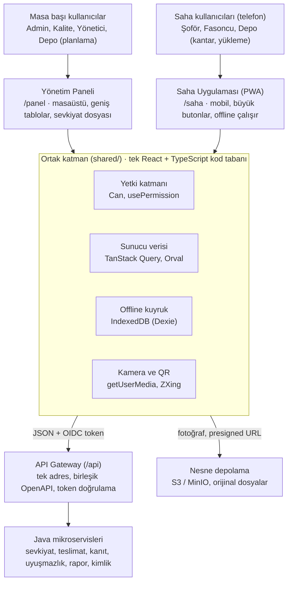

# İplik Sevkiyat Sistemi – React Frontend Mimarisi

| | |
| --- | --- |
| Sürüm | 1.0 (taslak) |
| Tarih | 20.10.2026 |
| Dayanak | İplik Sevkiyat Ön Analiz Raporu v1.1 |
| Durum | Proje sahibinin onayı bekleniyor |

## Özet ve temel kararlar

Öneri: tek bir React + TypeScript kod tabanı, iki ayrı arayüz kabuğu ile. Masaüstü "Yönetim Paneli" (Admin, Kalite, Yönetici, Depo) ve telefona göre tasarlanmış, PWA olarak kurulabilen "Saha Uygulaması" (Şoför, Fasoncu, Depo sahada). Ön analizdeki native uygulama kapsam dışı kararıyla uyumludur (Bölüm 4.2).

| Konu | Karar | Kısa gerekçe |
| --- | --- | --- |
| Dil ve build | React 19, TypeScript (strict), Vite | Tip güvenliği, hızlı geliştirme, yaygın ekosistem |
| Uygulama tipi | SPA + PWA (vite-plugin-pwa) | Mağaza gerekmez, ana ekrana eklenir, zayıf bağlantıda çalışır |
| Routing | React Router v7, lazy route'lar | Rol bazlı route koruma, kod bölme |
| Sunucu verisi | TanStack Query v5 | Önbellek, yeniden deneme, offline mutation desteği |
| İstemci durumu | Zustand (küçük, sınırlı) | Oturum, offline kuyruk durumu, UI tercihleri |
| UI kütüphanesi | Mantine v7 + TanStack Table | Hem masaüstü tablo hem büyük butonlu mobil ekran, Türkçe tarih/sayı desteği |
| Formlar | React Hook Form + Zod | Performanslı, tek şemayla doğrulama ve tip |
| API katmanı | OpenAPI'den otomatik üretilen istemci (Orval) | Java servisleriyle sözleşme tek kaynaktan, elle tip yazılmaz |
| Kimlik doğrulama | OIDC Authorization Code + PKCE | Yetkilendirme analizinde seçilecek kimlik sağlayıcıyla (ör. Keycloak) uyumlu |
| Offline ve fotoğraf | IndexedDB (Dexie) kuyruğu + uygulama içi kamera | Çekim ve gönderim zamanı ayrı tutulur, galeri yüklemesi işaretlenir |
| Test | Vitest, Testing Library, MSW, Playwright | Backend hazır olmadan sahte API ile paralel geliştirme |

En önemli tasarım ilkesi: kör giriş ve yetki kuralları backend'de uygulanır. Frontend gizli alanı "saklamaz", o alan API yanıtında hiç gelmez. Frontend yalnızca backend'in verdiği yetki ve izin verilen aksiyon listesine göre ekranı şekillendirir.

## Teknoloji seçimleri ve değerlendirilen alternatifler

Seçimler üç şarta göre yapıldı: saha personelinin telefonda birkaç dokunuşla işini bitirmesi, yöneticinin tek ekranda sevkiyat dosyasını görmesi (Bölüm 19) ve Java mikroservisleriyle sözleşmenin kaymaması.

| Alan | Seçilen | Alternatif | Neden alternatif değil |
| --- | --- | --- | --- |
| Framework | Vite + React SPA | Next.js | SSR/SEO ihtiyacı yok; backend Java, ayrı Node sunucusu işletme yükü getirir. Statik dosya Nginx'ten servis edilir |
| UI | Mantine v7 | MUI, Ant Design, shadcn/ui | MUI ve AntD masaüstüne ağırlıklı ve paket boyutu büyük; shadcn/ui esnek ama form, tarih, bildirim bileşenlerini ekibin kendisi tamamlaması gerekir |
| Tablo | TanStack Table | AG Grid | Rapor ekranları için yeterli, ücretsiz; AG Grid Enterprise ileride Excel dışa aktarımı için değerlendirilebilir (Faz 2) |
| Sunucu verisi | TanStack Query | Redux Toolkit Query | Daha az kalıp kod, Orval ile doğrudan hook üretimi, offline mutation duraklatma |
| İstemci durumu | Zustand | Redux | Global istemci durumu çok az; Redux burada fazla kalıp kod demek |
| Routing | React Router v7 | TanStack Router | Ekip bilgisi ve doküman bolluğu; TanStack Router da uygun bir alternatif |
| QR / barkod | BarcodeDetector API, yoksa @zxing/browser | html5-qrcode | ZXing daha bakımlı; Android Chrome'da yerel API çok hızlı |
| Grafikler | Recharts | ECharts | Dashboard grafikleri basit; ECharts büyük veri gerekirse |
| Tarih / sayı | dayjs (tr), Intl tr-TR | moment | 2.000 kg, %0,9 gibi Türkçe biçimler Intl ile doğru çıkar |
| Çoklu dil | react-i18next | sabit metin | Başta yalnızca Türkçe; metinler anahtarla tutulur, ileride dil eklemek kolay olur |

Paket yöneticisi pnpm, Node 22 LTS. Kod kalitesi için ESLint (typescript-eslint), Prettier ve commit öncesi lint-staged kullanılır.

## Proje ve klasör yapısı

Kod, teknik katmana göre değil iş modülüne göre bölünür (feature-based). Her modül backend'deki bir mikroservise denk gelir; böylece servis sınırları değiştiğinde yalnızca ilgili klasör etkilenir. Başlangıçta tek repo ve tek uygulama yeterlidir; ikinci bir frontend uygulaması gerekirse pnpm workspace ile `packages/ui` ve `packages/api` ayrılır.

```
iplik-sevkiyat-web/
  src/
    app/              # uygulama kabuğu: provider'lar, router, tema, hata sınırı
      router.tsx
      providers.tsx
      layouts/
        PanelLayout.tsx   # masaüstü: yan menü, üst bar, geniş tablolar
        SahaLayout.tsx    # mobil: alt gezinme, büyük butonlar, offline göstergesi
    modules/          # iş modülleri (backend servisleriyle eşleşir)
      auth/           # giriş, oturum, yetki hook'ları
      tanimlar/       # fasoncu, şoför, araç, ürün, parti, kalite
      cuval/          # Unique Key, etiket basımı
      sevkiyat/       # sevkiyat oluşturma, çuval atama, çıkış, mühür
      teslimat/       # şoför beyanı, fasoncu kör giriş
      kanit/          # fotoğraf, belge, kamera, yükleme kuyruğu
      uyusmazlik/     # uyuşmazlık ve kalite itirazı, karar
      denetim/        # audit log görüntüleme
      rapor/          # dashboard, risk göstergeleri
      bildirim/       # uygulama içi bildirimler
      yonetim/        # kullanıcı, rol, sistem ayarları (tolerans, zorunlu kanıt)
        pages/  components/  hooks/  schemas/  routes.tsx
    shared/
      api/            # Orval çıktısı (generated/) + axios istemcisi, interceptor'lar
      ui/             # ortak bileşenler: DataTable, StatusBadge, KgInput, FileCard
      offline/        # Dexie veritabanı, gönderim kuyruğu, ağ durumu
      lib/            # biçimlendirme (kg, %), tarih, hash, hata eşleme
      i18n/           # tr.json
    test/             # MSW handler'ları, test yardımcıları
  e2e/                # Playwright senaryoları (masaüstü + mobil görünüm)
  public/             # manifest, ikonlar
```

Kurallar:

- Bir modül başka bir modülün içine doğrudan import yapmaz; ortak ihtiyaç `shared/` altına taşınır (ESLint `import/no-restricted-paths` ile zorlanır).
- `shared/api/generated` elle düzenlenmez; backend OpenAPI değişince yeniden üretilir ve CI'da fark kontrol edilir.
- Her sayfa lazy yüklenir; saha kullanıcısı yönetim paneli kodunu hiç indirmez.



Saha Uygulaması fotoğrafları presigned URL ile doğrudan nesne depolamaya yükler; diğer tüm istekler Gateway üzerinden servislere gider.

## Routing ve rol bazlı ekranlar

Girişten sonra kullanıcı rolüne göre kendi kabuğuna yönlendirilir: `/panel/*` masaüstü, `/saha/*` mobil. Depo personeli iki kabuğu da kullanabilir (planlama masada, tartım ve fotoğraf sahada). Her route bir yetki anahtarı taşır; yetkisi olmayan kullanıcı menüde o sayfayı görmez, adresi elle yazarsa 403 sayfasına düşer.

| Rol | Kabuk | Ana ekranlar |
| --- | --- | --- |
| Admin | Panel | Tanımlar, kullanıcı/rol, sistem ayarları (tolerans bantları, zorunlu kanıtlar), gerekçeli düzeltme, iptal, audit log, tüm raporlar |
| Depo Personeli | Panel + Saha | Sevkiyat oluşturma, şoför/araç atama, çuval okutma veya toplu liste, çıkış tartımı (brüt/dara/net), mühür no, çıkış fotoğrafları, etiket basımı |
| Şoför | Saha | "Bana atanan sevkiyatlar" listesi, yükü teslim aldım (çuval sayısı + mühür teyidi), vardım / teslim ettim, mühür sağlam mı |
| Fasoncu | Saha (masaüstünde de açılır) | Gelen sevkiyatlar, kör teslim girişi sihirbazı, teslim fotoğrafları, imzalı belge, kalite itirazı, kendi uyuşmazlık sonuçları |
| Kalite / Yetkili | Panel | Uyuşmazlık kutusu (Sarı/Kırmızı, süresi geçen), sevkiyat dosyası, numune/lab talebi, karar formu, audit log |
| Yönetici | Panel (salt okuma) | Dashboard, risk göstergeleri, sevkiyat dosyası görüntüleme; hiçbir düzenleme butonu görünmez |

### Sevkiyat dosyası ekranı

Yönetici ve Kalite için merkez ekran `/panel/sevkiyat/:id`'dir ve Bölüm 19'daki yedi soruyu tek sayfada cevaplar: üst kartta fasoncu, şoför, araç ve durum; sekmelerde Çuvallar, Kilolar (çıkış / teslim / fark ve bant rengi), Mühür, Kanıtlar (fotoğraf galerisi + belge), Beyanlar, Uyuşmazlıklar ve Geçmiş (audit log). Sekmeler ayrı sorgularla yüklenir, ilk açılış birkaç saniye hedefini (Bölüm 14) tutturur.

### Yetki modeli frontend'de nasıl kullanılır

- Token'daki rol yerine ince taneli yetki anahtarları kullanılır (ör. `sevkiyat:olustur`, `teslim:kilo:gir`, `uyusmazlik:karar`). Anahtar listesi yetkilendirme analiziyle ortak tutulur.
- `usePermission('uyusmazlik:karar')` hook'u ve `<Can permission="...">` bileşeni menü, buton ve sekmeleri yönetir.
- Durum geçişleri frontend'de tekrar kodlanmaz. Sevkiyat yanıtı `allowedActions` listesi taşır (ör. `["SOFOR_TESLIM_ALDI"]`); buton yalnızca listede varsa görünür. Durum makinesi tek yerde, backend'de kalır.
- Kör giriş: fasoncunun teslim ekranına giden API yanıtında çıkış kilosu ve çuval sayısı alan olarak hiç yoktur. Karşılaştırma bittikten sonra sonuç ayrı bir uçtan gelir. Frontend'de "alanı gizle" yaklaşımı kabul edilmez, çünkü tarayıcı araçlarıyla görülebilir.
- Kilitli alanlar backend'den `locked: true` ile gelir ve salt okuma gösterilir; Admin için yanında "Gerekçeli düzeltme" aksiyonu çıkar.

## State yönetimi, API katmanı ve formlar

Verinin %90'ı sunucu verisidir ve TanStack Query'de yaşar; Zustand yalnızca sunucuda karşılığı olmayan küçük istemci durumunu tutar.

| Durum türü | Nerede | Örnek |
| --- | --- | --- |
| Sunucu verisi | TanStack Query | Sevkiyat listesi, sevkiyat dosyası, uyuşmazlıklar, tanımlar |
| Oturum | Zustand (bellekte) | Kullanıcı, yetki anahtarları, access token |
| Offline kuyruk | Dexie (IndexedDB) + Zustand özeti | Bekleyen fotoğraf ve beyan sayısı, son senkron zamanı |
| Form taslakları | React Hook Form + IndexedDB | Yarım kalan kör teslim girişi, uygulama kapanırsa kaybolmaz |
| Liste filtreleri | URL query parametreleri | `?durum=INCELEMEDE&fasoncu=12`, paylaşılabilir link |

### API katmanı

- Tüm istekler API Gateway üzerinden tek adrese gider (`/api/...`). Frontend mikroservis adreslerini bilmez; servis bölünmesi değişse de frontend etkilenmez.
- Her Java servisi springdoc ile OpenAPI yayınlar. Gateway bunları birleştirir; Orval bu şemadan TypeScript tiplerini, axios fonksiyonlarını ve TanStack Query hook'larını üretir. Zod şemaları da aynı kaynaktan üretilebilir.
- Axios interceptor'ı: token ekler, 401'de sessiz yenileme dener, `X-Request-Id` ve cihaz bilgisi başlığı gönderir (audit log'daki "hangi cihazdan" bilgisi için).
- Hata biçimi tüm servislerde RFC 9457 Problem Details olmalı (`type`, `title`, `detail`, `errors[]`). Frontend alan hatalarını doğrudan form alanına bağlar. Bu konu backend analizleriyle ortak karar olarak önerilir.
- Eşzamanlı düzenleme: güncelleme isteklerinde `version` (ETag / If-Match) gönderilir; 409 gelirse kullanıcıya "kayıt başkası tarafından güncellendi" gösterilir.
- Offline'dan gelen tekrar denemeler için her mutasyon bir `Idempotency-Key` taşır; aynı beyan iki kez kaydedilmez.
- Bildirimler: Kırmızı uyuşmazlık ve süresi geçen inceleme için Server-Sent Events ile anlık akış; SSE kurulamazsa 60 sn aralıklı sorgu.

### Formlar

- React Hook Form + Zod: her formun şeması `schemas/` altında, tip bu şemadan çıkar.
- Kilo girişi için ortak `KgInput`: Türkçe ondalık virgül, binlik nokta, sayısal klavye (`inputMode="decimal"`); net = brüt − dara otomatik hesaplanır, kullanıcı neti elle yazmaz.
- Dara standart değerden sapınca (Bölüm 9.1) alan altında uyarı çıkar ama kayıt engellenmez; nihai kural backend'dedir. Tolerans yüzdeleri sabit kodlanmaz, sistem ayarlarından okunur.
- Saha formları adım adım sihirbazdır (bir ekranda tek iş), masaüstü formları tek sayfadır.
- Gerekçeli düzeltme formu: eski değer, yeni değer ve zorunlu gerekçe alanı yan yana gösterilir; eski değer silinmez.

## Mobil saha kullanımı, fotoğraf yükleme ve zayıf bağlantı

Saha Uygulaması bir PWA'dır: mağazadan indirilmez, linkten açılıp ana ekrana eklenir, uygulama dosyaları cihazda önbelleklenir ve kantar gibi çekmeyen alanlarda da açılır. Hedef cihaz Android Chrome ve iOS Safari'nin son iki ana sürümü.

### Ekran ilkeleri

- Bir ekranda tek iş, altında tek büyük ana buton (en az 48 px yükseklik, tek elle ulaşılabilir alt bölüm).
- Şoför akışı en fazla 3 dokunuş: sevkiyatı seç → çuval sayısı ve mühür no teyidi → "Teslim aldım".
- Fasoncu kör teslim sihirbazı: 1) mühür no + mühür fotoğrafı, 2) çuvalları tek tek okut (sayı canlı artar, beklenen sayı gösterilmez), 3) brüt/dara + kantar fotoğrafı, 4) çuval fotoğrafları, 5) imzalı belge fotoğrafı ve belgedeki kilo/tarih/sevkiyat no, 6) özet ve gönder.
- Üst barda kalıcı bağlantı göstergesi: "Çevrim içi", "Çevrim dışı – 3 kayıt bekliyor", "Gönderiliyor".
- Güneş altında okunabilirlik için yüksek kontrastlı tema, büyük yazı; A ve B kaliteyi renkle birlikte metinle de göster (renk körlüğü).

### Uygulama içi kamera

- Fotoğraf `getUserMedia` ile açılan uygulama içi kamera bileşeninden çekilir; galeriden seçme düğmesi yoktur. Kamera izni verilmezse dosya seçiciye düşülür ve kayıt `kaynak: GALERI` olarak işaretlenir (Bölüm 11.2, uyuşmazlık türü "Fotoğraf").
- Kamera ekranında fotoğraf türü ve sevkiyat no üstte yazar (ör. "Çıkış kantar fişi – SVK-2026-0142"); zorunlu fotoğraflar kontrol listesi olarak görünür, eksik varken "Gönder" pasiftir.
- Çekilen kare JPEG olarak uzun kenarı en fazla 2560 px'e indirilir (sevkiyat başına 10–15 fotoğraf kapasite hedefi). Bu dosya "orijinal" kabul edilir; sonrasında hiçbir işlem görmez.
- Tarayıcıda WebCrypto ile SHA-256 hesaplanır ve dosyayla gönderilir; sunucu kendi hash'ini hesaplayıp karşılaştırır. Filigran sunucuda ayrı bir türev kopyaya basılır, orijinal korunur.
- Konum yalnızca KVKK onayı alınmış kullanıcıdan ve çekim anında bir kez okunur; izin yoksa fotoğraf yine kaydedilir.

### QR / barkod okutma

- Varsa yerel `BarcodeDetector` API, yoksa `@zxing/browser`. Kamera sürekli açık kalır, her okutmada titreşim ve ses geri bildirimi verilir.
- Aynı Unique Key ikinci kez okutulursa anında uyarı verilir. Başka sevkiyata ait anahtarın kontrolü sunucudadır; fasoncu ekranında beklenen liste olmadığı için yalnızca "okundu" bilgisi gösterilir (kör giriş).
- Okunamayan etiket için elle giriş vardır ve `girisYontemi: ELLE` olarak raporlanır.

### Offline kuyruk ve yükleme akışı

1. Kullanıcı fotoğrafı çeker veya beyanı kaydeder. Kayıt önce IndexedDB'ye yazılır; `cekimZamani` (cihaz saati) ve `idempotencyKey` o anda oluşturulur.
2. Bağlantı varsa hemen gönderilir. Fotoğraflar için kanıt servisinden imzalı yükleme adresi (presigned URL) alınır ve dosya doğrudan nesne depolamaya (S3/MinIO) yüklenir, ardından meta veri servise kaydedilir.
3. Bağlantı yoksa kayıt kuyrukta bekler. `online` olayında, uygulama öne geldiğinde ve 30 sn aralıklarla tekrar denenir (artan bekleme). iOS Background Sync desteklemediği için uygulama açıkken gönderim esas alınır.
4. Sunucu `gonderimZamani`nı kendisi yazar; cihaz saati ile sunucu saati arasındaki fark da saklanır. İkisi arasındaki uzun fark "zaman anomalisi" kuralına girdi olur.
5. Kuyruk boşalmadan oturum kapatılmaz; kullanıcıya "gönderilmemiş 2 kayıt var" uyarısı çıkar. `navigator.storage.persist()` ile tarayıcının verileri silmesi engellenmeye çalışılır.

Bir beyan ancak ona bağlı zorunlu fotoğraflar sunucuya ulaştığında "tamam" sayılır; sevkiyat durumunun ilerlemesine backend karar verir.

## Kalite, güvenlik, yayına alma ve yol haritası

### Test

- Birim ve bileşen testleri: Vitest + Testing Library. Öncelik net kilo hesabı, biçimlendirme, offline kuyruk ve yetkiye göre görünürlük.
- MSW ile sahte API: OpenAPI örneklerinden üretilir; frontend backend servisleri bitmeden ilerler.
- Uçtan uca: Playwright, masaüstü ve Pixel/iPhone görünümlerinde. Zorunlu senaryolar: tam sevkiyat döngüsü (Taslak → Tamamlandı), kör girişte çıkış kilosunun yanıtta olmaması, offline fotoğraf çekip sonradan gönderme, Yönetici rolünde hiç düzenleme butonu olmaması.
- Erişilebilirlik: axe kontrolü CI'da; dokunma hedefleri en az 48 px.

### Güvenlik

- Access token yalnızca bellekte tutulur, localStorage kullanılmaz. Yenileme, kimlik sağlayıcının önerdiği yöntemle yapılır (refresh token rotasyonu veya BFF ile httpOnly çerez); seçim yetkilendirme analiziyle birlikte kesinleşir.
- Admin ve Kalite için iki adımlı doğrulama kimlik sağlayıcının giriş ekranında yapılır; frontend kendi giriş formunu yazmaz.
- Content-Security-Policy, yalnızca HTTPS, ortak hesap yok. IndexedDB'deki bekleyen kayıtlar oturum kapanınca (gönderildikten sonra) silinir.

### Yayına alma

- `vite build` çıktısı Nginx konteynerinde servis edilir ve API Gateway ile aynı alan adı altında yayınlanır (CORS gerekmez).
- Ortama özel ayarlar (API adresi, kimlik sağlayıcı adresi) build'e gömülmez, açılışta `/config.json`'dan okunur; aynı imaj test ve canlıda kullanılır.
- Yeni sürüm çıktığında PWA "Güncelleme var, yenile" bildirimi gösterir; offline kuyruk boşken yeniler.
- Hata izleme: Sentry (veya kurum içi eşdeğeri), kullanıcı kişisel verisi gönderilmeden.

### Yol haritası (ön analiz Bölüm 17 ile hizalı)

| Faz | Frontend kapsamı |
| --- | --- |
| 0 – Hazırlık | Proje iskeleti, tema, iki kabuk, giriş ve yetki altyapısı, Orval + MSW kurulumu, ekran taslaklarının sahada denenmesi |
| 1 – MVP | Tanımlar, çuval ve etiket, sevkiyat ve durum akışı, mühür, uygulama içi kamera ve offline kuyruk, fasoncu kör girişi, imzalı belge, uyuşmazlık kutusu ve karar, audit log, temel dashboard, QR okutma, bildirimler |
| Pilot (4–6 hafta) | Saha geri bildirimiyle adım sayısı ve zorunlu fotoğraf listesinin ayarlanması; tolerans ayarları ekrandan değiştirilebilir olduğu için kod değişmez |
| 2 | Risk skoru ekranları, Excel/PDF sevkiyat dosyası dışa aktarımı, laboratuvar sonucu formu, e-İrsaliye eşleştirme alanı |
| 3 | Kantar, GPS ve RFID verisinin ekranlarda gösterimi (giriş alanları salt okumaya döner) |

### Diğer analizlerle netleşmesi gerekenler

- Yetkilendirme: kimlik sağlayıcı seçimi, token mu BFF mi, yetki anahtarı listesi.
- Backend mikroservisleri: Gateway yolu, OpenAPI birleştirme, Problem Details hata biçimi, `allowedActions` alanı, Idempotency-Key desteği.
- Veritabanı / depolama: fotoğraflar için nesne depolama (S3/MinIO) ve presigned URL akışı.
- Kod kuralları: Java 25 kod kuralları dokümanı kesinleştiğinde, frontend için de benzer bir TypeScript/React kural dokümanı hazırlanabilir.
