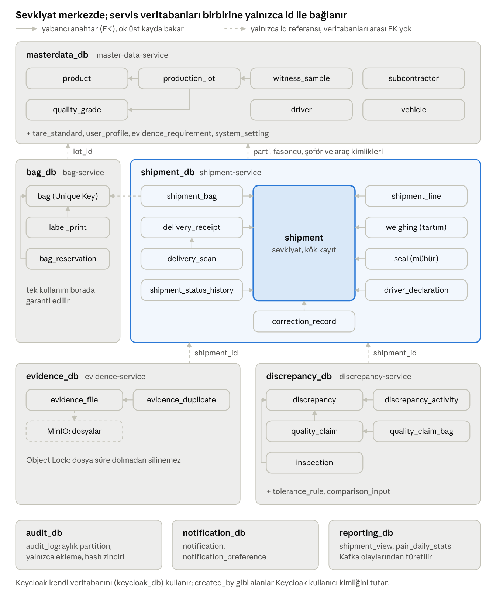

# İplik Sevkiyat Sistemi – Veritabanı Tasarımı

Sürüm: v1 · Tarih: 20.10.2026 · Kaynak: Ön analiz raporu v1.1 ve Java mikroservis mimarisi v1

## Özet ve teknoloji seçimi

Öneri: ilişkisel veriler için **PostgreSQL 17**, fotoğraf ve belgeler için **S3 uyumlu nesne depolama (MinIO, Object Lock açık)**, şema yönetimi için **Flyway**. Her mikroservis kendi veritabanına sahip olur; Faz 1'de hepsi tek bir PostgreSQL kümesinde ayrı veritabanları olarak çalışır.

Gerekçe, ön analiz raporu v1.1'in istediklerinden geliyor:

- **Kanıt zinciri ve değiştirilemezlik** (Bölüm 3, 11): sevkiyat, çuval, tartım ve uyuşmazlık kayıtları birbirine sıkı bağlı. Yabancı anahtar, CHECK ve kısmi unique indeks gibi kısıtlar bu kuralları veritabanı seviyesinde garanti eder.
- **Unique Key bir kez kullanılır** (Bölüm 8): tek bir kısmi unique indeksle ve aynı transaction içinde zorlanabilir.
- **Audit Log** (Bölüm 3): JSONB ile değişikliğin önceki/sonraki hali esnek saklanır; aylık partition ile büyüme yönetilir; yalnızca INSERT yetkisi verilerek silinemez hale getirilir.
- **Raporlar** (Bölüm 13): şoför, fasoncu ve şoför–fasoncu eşleşmesi bazında oranlar SQL ile doğrudan hesaplanır.
- **Maliyet ve ekosistem**: lisans ücreti yok; Spring Boot, Spring Data JPA, Flyway ve Testcontainers ile birinci sınıf destek.

| Seçenek | Karar | Neden |
| --- | --- | --- |
| PostgreSQL 17 | Seçildi | Güçlü kısıtlar, JSONB, partition, RLS, ücretsiz |
| MySQL 8 | Alternatif | Yeterli olur, ancak kısmi indeks ve RLS yok |
| MS SQL / Oracle | Önerilmez | Lisans maliyeti, bu ölçekte gereksiz |
| MongoDB | Önerilmez | Çok tablolu tutarlılık ve ilişkisel raporlar zorlaşır |
| MinIO / S3 | Seçildi (dosyalar) | Fotoğraflar veritabanında tutulmaz; Object Lock ile silinemez saklama |
| Redis | İsteğe bağlı | Oturum/önbellek gerekirse; kayıt kaynağı değil |

Genel kurallar: birincil anahtarlar `uuid` (UUIDv7, zaman sıralı), kilolar `numeric(12,3)`, zamanlar `timestamptz` (UTC saklanır, ekranda Europe/Istanbul). Tablo ve kolon adları Java entity'leriyle uyumlu olsun diye İngilizce `snake_case`; açıklamalar Türkçe.

## Servis başına veritabanı

Mikroservis mimarisi dokümanındaki (java\_mikroservis\_mimarisi\_v1) 8 servisin her biri kendi veritabanına sahiptir; bir veritabanını yalnızca sahibi olan servis okur ve yazar. Keycloak da kendi veritabanını kullanır. Hepsi tek bir PostgreSQL sunucusunda ayrı veritabanları olarak çalışır.

| Veritabanı | Sahip servis | Tuttuğu veri |
| --- | --- | --- |
| `masterdata_db` | master-data-service | Fasoncu, şoför, araç, iplik, kalite, parti ve kalite kilidi, şahit numune, standart dara, kullanıcı profili (kullanıcı–fasoncu/şoför bağı) |
| `bag_db` | bag-service | Çuval (Unique Key), etiket baskısı, çuval rezervasyonu ve tek kullanım garantisi |
| `shipment_db` | shipment-service | Sevkiyat, çuval listesi kopyası, tartım, mühür, şoför beyanı, kör teslim girişi, durum geçmişi, düzeltme kayıtları |
| `evidence_db` + MinIO | evidence-service | Fotoğraf/belge üst verisi, SHA-256, zaman damgaları; dosyanın kendisi MinIO'da |
| `discrepancy_db` | discrepancy-service | Tolerans kuralları, uyuşmazlık, kalite itirazı, karar, fiziki kontrol/numune/lab |
| `audit_db` | audit-service | Değiştirilemez Audit Log (yalnızca ekleme, hash zinciri) |
| `notification_db` | notification-service | Bildirim ve bildirim tercihi |
| `reporting_db` | reporting-service | Olaylardan türetilen okuma modelleri (dashboard, eşleşme istatistikleri) |
| `keycloak_db` | Keycloak | Kullanıcı, şifre, rol, iki adımlı doğrulama; Keycloak kendisi yönetir |

`reporting_db` hiçbir zaman kayıt kaynağı değildir: silinip Kafka olaylarından yeniden oluşturulabilir. Faz 2'deki risk skoru ve rastgele kontrol seçimi de burada hesaplanır.

Servisler arası kurallar:

1. **Başka servisin tablosuna JOIN veya yabancı anahtar yok.** Başka servise ait kayıt yalnızca kimliğiyle tutulur (`subcontractor_id uuid`, FK yok).
2. **Anlık görüntü (snapshot) kolonları:** sevkiyatın fasoncu unvanı, plaka ve şoför adı oluşturma anında kopyalanır. Böylece ana veri sonradan değişse de sevkiyat dosyası o günkü haliyle kalır.
3. **Kalite çuvala partiden gelir ve kilitlidir** (rapor Bölüm 10): çuval oluşturulurken partinin kalitesi `bag.quality_grade_code` kolonuna yazılır; parti kalitesi kilitlenmeden çuval oluşturulamaz.
4. **Transactional outbox:** her servis değişikliği ve yayınlanacak olayı (örn. `DeliveryReceived`) aynı transaction içinde kendi `outbox_event` tablosuna yazar. Bir aktarıcı bunları mesaj kuyruğuna (Kafka veya RabbitMQ, mikroservis thread'inin kararı) iletir. Audit, uyuşmazlık ve bildirim servisleri bu olaylarla beslenir.
5. **İdempotent tüketim:** olay tüketen her servis `processed_event(event_id)` tablosu tutar; aynı olay iki kez işlenmez.

## Tablo yapıları

Her tabloda ayrıca `id uuid PK`, `created_at`, `created_by`, `updated_at`, `updated_by` ve iyimser kilit için `version int` vardır; tekrar edilmemiştir. Kritik ölçüm tabloları (tartım, mühür, beyan, teslim) **hiç güncellenmez**: düzeltme yeni satır ekler, eski satır `superseded_by` ile işaretlenir.

### Kimlik: Keycloak ve user\_profile

| Tablo | Önemli kolonlar | Kısıt / not |
| --- | --- | --- |
| Keycloak (kendi şeması) | kullanıcı, şifre, roller (ADMIN, WAREHOUSE, DRIVER, SUBCONTRACTOR, QUALITY, MANAGER), iki adımlı doğrulama | Elle tablo yazılmaz; Keycloak yönetir |
| `user_profile` (masterdata\_db) | keycloak\_user\_id, full\_name, user\_type (INTERNAL, DRIVER, SUBCONTRACTOR), subcontractor\_id, driver\_id, status | keycloak\_user\_id unique; DRIVER ise driver\_id, SUBCONTRACTOR ise subcontractor\_id zorunlu (CHECK) |

Tüm servislerdeki `created_by`, `assignee_id` gibi kullanıcı alanları Keycloak kullanıcı kimliğini (`uuid`) tutar. Yetkilendirme çalışması ayrı bir user-service önerirse `user_profile` oraya taşınır; yapısı değişmez.

### masterdata\_db

| Tablo | Önemli kolonlar | Kısıt / not |
| --- | --- | --- |
| `subcontractor` (fasoncu) | code, title, tax\_no, address, contact\_name, phone, email, status | code ve tax\_no unique |
| `driver` (şoför) | full\_name, national\_id\_enc, phone, license\_no, employer\_type (OWN, CONTRACTED), status | TCKN şifreli (pgcrypto), KVKK |
| `vehicle` (araç) | plate\_no, vehicle\_type, status | plate\_no unique |
| `product` (iplik) | code, name, yarn\_count, composition, packaging\_type | code unique |
| `quality_grade` (kalite) | code (A, B, …), name, label\_color | code unique |
| `production_lot` (parti) | lot\_no, product\_id, quality\_grade\_id, production\_date, quality\_locked\_at, quality\_locked\_by, status | lot\_no unique; kilitlendikten sonra quality\_grade\_id değişemez (trigger) |
| `witness_sample` (şahit numune) | lot\_id, sample\_code, storage\_location, taken\_at, disposed\_at | sample\_code unique |
| `tare_standard` (standart dara) | packaging\_type, standard\_tare\_kg, max\_deviation\_pct | packaging\_type unique |
| `user_profile` | yukarıdaki Kimlik tablosu | — |
| `evidence_requirement` | stage (DISPATCH, DELIVERY, CLAIM), evidence\_type, min\_count, mandatory | Rapor Bölüm 11.1 ayarları |
| `system_setting` | key, value jsonb | itiraz süresi, rastgele kontrol oranı vb. |

### bag\_db

| Tablo | Önemli kolonlar | Kısıt / not |
| --- | --- | --- |
| `bag` (çuval) | unique\_key, lot\_id, lot\_no, product\_id, quality\_grade\_code, status (CREATED, RESERVED, SHIPPED, DELIVERED, VOID) | unique\_key unique; kalite partiden kopyalanır, elle girilmez; parti kalitesi kilitli değilse çuval oluşturulamaz |
| `label_print` (etiket baskısı) | bag\_id, printed\_at, printed\_by, reprint\_reason | yeniden baskıda gerekçe zorunlu |
| `bag_reservation` | bag\_id, shipment\_id, reserved\_at, reserved\_by, released\_at, release\_reason | **kısmi unique (bag\_id) WHERE released\_at IS NULL**: bir çuval aynı anda tek sevkiyatta. SevkiyatIptalEdildi gelince rezervasyon bırakılır |

Unique Key'in tek kullanımı burada, tek veritabanı işlemiyle garanti edilir. shipment-service okutmayı REST ile bag-service'e sorar; anahtar başka sevkiyattaysa depo personeli bunu okuttuğu anda görür.

### shipment\_db

| Tablo | Önemli kolonlar | Kısıt / not |
| --- | --- | --- |
| `shipment` (sevkiyat) | shipment\_no, subcontractor\_id, subcontractor\_title, driver\_id, driver\_name, vehicle\_id, plate\_no, status, planned\_net\_kg, planned\_bag\_count, e\_waybill\_no, random\_check\_selected, random\_check\_revealed\_at, locked\_at, cancelled\_reason | shipment\_no unique; status CHECK (DRAFT, LOADED, IN\_TRANSIT, AWAITING\_DELIVERY, CHECKING, IN\_REVIEW, COMPLETED, CANCELLED) |
| `shipment_line` (plan) | shipment\_id, product\_id, lot\_id, quality\_grade\_code, planned\_kg, planned\_bag\_count | FK shipment |
| `shipment_bag` | shipment\_id, bag\_id, unique\_key, lot\_no, quality\_grade\_code, scan\_method (SCAN, LIST, MANUAL), assigned\_at, assigned\_by, removed\_at | bag-service rezervasyonu başarılı olunca yazılır; çuval bilgisi kopya, FK yok. (shipment\_id, bag\_id) unique |
| `weighing` (tartım) | shipment\_id, side (DISPATCH, DELIVERY), gross\_kg, tare\_kg, net\_kg (generated: gross − tare), bag\_count, scale\_ticket\_no, weighed\_at, entered\_by, superseded\_by | kısmi unique (shipment\_id, side) WHERE superseded\_by IS NULL; CHECK gross ≥ tare ≥ 0 |
| `seal` (mühür) | shipment\_id, side, seal\_no, condition (INTACT, DAMAGED, MISSING), recorded\_by, recorded\_at, superseded\_by | aynı kısmi unique kuralı; DISPATCH tarafında seal\_no unique (mühür tek kullanımlık) |
| `driver_declaration` | shipment\_id, type (PICKUP, ARRIVAL), driver\_id, bag\_count, seal\_no, seal\_intact, declared\_at, device\_info jsonb | (shipment\_id, type) unique |
| `delivery_receipt` (kör teslim) | shipment\_id, received\_by, received\_at, signed\_doc\_evidence\_id, doc\_shipment\_no, doc\_date, doc\_net\_kg, doc\_bag\_count, submitted\_at | shipment\_id unique; submitted\_at dolunca kilitlenir |
| `delivery_scan` | delivery\_receipt\_id, scanned\_key, matched (bool), scan\_method, scanned\_at | (receipt\_id, scanned\_key) unique; listede olmayan anahtar da saklanır |
| `shipment_status_history` | shipment\_id, from\_status, to\_status, changed\_by, changed\_at, reason | yalnızca ekleme |
| `correction_record` (düzeltme) | entity\_type, entity\_id, field\_name, old\_value, new\_value, reason, requested\_by, approved\_by, approved\_at | gerekçe zorunlu; yalnızca Admin onayı (rapor karar #9) |
| `outbox_event` | aggregate\_type, aggregate\_id, event\_type, payload jsonb, occurred\_at, published\_at | tüm servislerde aynı yapı |

**Kör giriş nasıl korunur:** fabrika ve fasoncu değerleri aynı `weighing` tablosunda `side` ile ayrılır. Fasoncu kullanıcısı için API `side = 'DISPATCH'` satırlarını sevkiyat `COMPLETED` veya `IN_REVIEW` olana kadar döndürmez. Ek güvence olarak PostgreSQL Row Level Security ile aynı kural veritabanında da tanımlanabilir (servis, istek başına `app.user_type` ayarı geçirir).

### evidence\_db

| Tablo | Önemli kolonlar | Kısıt / not |
| --- | --- | --- |
| `evidence_file` | shipment\_id, discrepancy\_id, evidence\_type (DISPATCH\_SCALE, BAG\_OVERVIEW, BAG\_LABEL, VEHICLE\_PLATE, SEAL, DELIVERY\_SCALE, DELIVERY\_BAGS, QUALITY\_CLAIM, SIGNED\_DELIVERY\_DOC, LAB\_RESULT), storage\_key, watermarked\_key, mime\_type, size\_bytes, sha256, source (CAMERA, GALLERY), captured\_at (cihaz), uploaded\_at (sunucu), uploaded\_by, device\_info jsonb, geo\_lat, geo\_lon, geo\_consent, status (VALID, INVALIDATED), invalidated\_reason | Silinmez; yanlış yükleme INVALIDATED olur. sha256 unique değil, tekrar kullanım sorguyla tespit edilir |
| `evidence_duplicate` | evidence\_id, duplicate\_of\_id, detected\_at | aynı hash başka sevkiyatta görülünce yazılır ve PHOTO uyuşmazlığı tetikler |

### discrepancy\_db

| Tablo | Önemli kolonlar | Kısıt / not |
| --- | --- | --- |
| `tolerance_rule` (tolerans) | product\_id (boş = genel), green\_max\_pct, yellow\_max\_pct, valid\_from, valid\_to | geçerlilik aralıkları çakışamaz (exclusion constraint) |
| `discrepancy` (uyuşmazlık) | discrepancy\_no, shipment\_id, type (QUANTITY, BAG, SEAL, QUALITY, DOCUMENT, PHOTO, TIME), severity (YELLOW, RED), status (OPEN, IN\_REVIEW, RESOLVED, CLOSED), rule\_code, expected\_value, actual\_value, diff\_kg, diff\_pct, assignee\_id, due\_at, resolution (TOLERANCE, DATA\_ERROR, CLAIM\_JUSTIFIED, CLAIM\_UNJUSTIFIED, LIABILITY\_ASSIGNED), resolution\_note, liable\_party, resolved\_by, resolved\_at, closed\_at | discrepancy\_no unique; RESOLVED için resolution ve not zorunlu (CHECK) |
| `discrepancy_activity` | discrepancy\_id, action\_type, note, evidence\_id, actor\_id, occurred\_at | yalnızca ekleme; yaşam döngüsü geçmişi |
| `quality_claim` (kalite itirazı) | discrepancy\_id, shipment\_id, subcontractor\_id, opened\_by, opened\_at, deadline\_at, description | deadline = teslim + 3 iş günü (rapor karar #7) |
| `quality_claim_bag` | claim\_id, bag\_id, unique\_key | PK (claim\_id, bag\_id) |
| `inspection` (fiziki kontrol, numune, lab) | shipment\_id, discrepancy\_id, reason (RANDOM, RISK, CLAIM), kind (PHYSICAL\_COUNT, SAMPLE, LAB), selected\_at, performed\_at, performed\_by, result, result\_evidence\_id | şoför/fasoncu API'sinde yola çıkana kadar gizli |
| `comparison_input` | shipment\_id, dispatch\_net\_kg, delivery\_net\_kg, dispatch\_bag\_keys jsonb, delivery\_bag\_keys jsonb, seal\_nos jsonb, received\_at | Olaylardan doldurulur; fabrika ve fasoncu değerlerini yan yana gören tek yer |

### audit\_db, notification\_db, reporting\_db

| Tablo | Önemli kolonlar | Kısıt / not |
| --- | --- | --- |
| `audit_log` | id bigint, occurred\_at, recorded\_at, source\_service, event\_id, actor\_user\_id, actor\_role, client\_id (SYSTEM işlerinde çağıran servis), action, decision (ALLOWED, DENIED; yetki kararları için), entity\_type, entity\_id, before jsonb, after jsonb, ip\_address, device\_info, user\_agent, trace\_id, prev\_hash, row\_hash | Aylık partition; event\_id unique (aynı olay iki kez yazılmaz). Hash zinciri: row\_hash = SHA-256(prev\_hash + satırın kanonik JSON'u) |
| `audit_chain_check` | checked\_at, from\_id, to\_id, ok, broken\_at\_id | Günlük zincir doğrulama işinin sonucu; bozulmada alarm |
| `notification` | recipient\_user\_id, channel (EMAIL, IN\_APP), template\_code, payload jsonb, status (PENDING, SENT, FAILED, READ), attempts, sent\_at, read\_at | — |
| `notification_preference` | user\_id, event\_type, channel, enabled | PK (user\_id, event\_type, channel) |
| `shipment_view` | shipment\_id, shipment\_no, subcontractor\_id, driver\_id, status, dispatch\_net\_kg, delivery\_net\_kg, diff\_pct, band, open\_discrepancy\_count, completed\_at | Dashboard; olaylardan güncellenir |
| `pair_daily_stats` | day, driver\_id, subcontractor\_id, shipment\_count, discrepancy\_count, total\_diff\_kg | PK (day, driver\_id, subcontractor\_id); şoför–fasoncu eşleşme raporu |

**Audit yetkileri (yetkilendirme analiziyle uyumlu):** audit-service'in yazan kullanıcısı `audit_writer` tabloya yalnız INSERT yapabilir; UPDATE, DELETE ve TRUNCATE hiçbir uygulama kullanıcısında yoktur. Kayıt, `SECURITY DEFINER` bir `audit_append()` fonksiyonuyla eklenir: fonksiyon advisory lock alır, son satırın hash'ini okur ve yeni satırı zincire bağlar. Böylece yazan kullanıcının SELECT yetkisi bile gerekmez. Audit ekranı için ayrı `audit_reader` kullanıcısı yalnız SELECT yapar.

## İlişkiler ve ER diyagramı

Tüm iş kayıtları `shipment` tablosuna bağlanır. Çuval ile sevkiyat arasındaki çoktan çoğa ilişki `shipment_bag` üzerinden kurulur, böylece bir çuvalın hangi sevkiyattan ne zaman çıkarıldığı da saklanır. Kesikli oklar farklı veritabanları arasındaki referanslardır ve veritabanında FK olarak tanımlanmaz.

## İndeksler ve performans

Veri hacmi küçük-orta ölçekte; büyüyen tek tablolar `audit_log` ve `evidence_file`. Unique kısıtlar kendi indekslerini oluşturur, aşağıdakiler ekrana ve rapora göre eklenir.

| Veritabanı | İndeks | Kullandığı ekran / sorgu |
| --- | --- | --- |
| bag\_db | `bag (unique_key)` unique | QR okutma, tekrar kullanım reddi |
| bag\_db | `bag_reservation (bag_id) WHERE released_at IS NULL` unique | Çuvalın tek sevkiyata bağlanması |
| bag\_db | `bag (lot_id, status)` | Partiden sevk edilebilir çuvallar |
| shipment\_db | `shipment (status, created_at DESC)` | Depo ve yönetici listeleri |
| shipment\_db | `shipment (subcontractor_id, status)` | Fasoncunun kendi sevkiyatları |
| shipment\_db | `shipment (driver_id, status)` | Şoförün kendi sevkiyatları |
| shipment\_db | `weighing (shipment_id, side) WHERE superseded_by IS NULL` unique | Geçerli tartım |
| shipment\_db | `shipment_status_history (shipment_id, changed_at)` | Zaman anomalisi (örn. 24 saatten uzun "Yolda") |
| evidence\_db | `evidence_file (shipment_id, evidence_type)` | Sevkiyat dosyasını tek ekranda açma |
| evidence\_db | `evidence_file (sha256)` | Aynı fotoğrafın tekrar yüklenmesi |
| discrepancy\_db | `discrepancy (status, severity, due_at)` | Süresi geçen uyuşmazlıklar, dashboard |
| discrepancy\_db | `discrepancy (shipment_id)` | Sevkiyat dosyası |
| discrepancy\_db | `discrepancy (assignee_id, status)` | "Bana atananlar" listesi |
| audit\_db | `audit_log (entity_type, entity_id, occurred_at)` | Bir kaydın geçmişi |
| audit\_db | `audit_log (actor_user_id, occurred_at)` | Kullanıcı bazında düzeltme raporu |
| reporting\_db | `shipment_view (status, completed_at)` | Dashboard |
| masterdata\_db | `production_lot (product_id, quality_grade_id)` | Parti seçimi |

Performans notları:

- `audit_log` ay bazında partition'lanır (`pg_partman`); eski partition'lar silinmez, gerekirse ucuz depolamaya taşınır.
- Sevkiyat dosyasının "birkaç saniyede" açılması (rapor Bölüm 14) için fotoğraflar MinIO'dan kısa ömürlü imzalı URL ile doğrudan tarayıcıya gelir, küçük önizleme (thumbnail) ayrıca saklanır.
- Şoför–fasoncu eşleşmesi raporları için reporting-service'te günlük yenilenen özet tablo (`pair_daily_stats`) tutulur; canlı tablolar raporlarla yüklenmez.
- Bağlantı havuzu: HikariCP, servis başına 10–20 bağlantı; PostgreSQL önünde PgBouncer.

## Ortak konular

**Değiştirilemezlik ve kilit.** Sevkiyat `COMPLETED` olduğunda `locked_at` dolar. Bir trigger, kilitli sevkiyata bağlı tartım, mühür, çuval ve teslim satırlarına UPDATE ve DELETE'i reddeder. Tek istisna Admin onaylı `correction_record` akışıdır; o da eski satırı değiştirmez, yenisini ekler.

**Silme yok.** Hiçbir iş tablosunda fiziksel DELETE yapılmaz. Tanımlar `status = PASSIVE`, kanıtlar `INVALIDATED`, çuval `VOID` olur. Uygulama veritabanı kullanıcısına kritik tablolarda DELETE yetkisi verilmez.

**Audit Log akışı.** Her servis değişikliği `outbox_event` ile yayınlar, audit-service bunu `audit_log`'a yazar. Kritik tablolarda ayrıca veritabanı trigger'ı yerel bir `audit_local` tablosuna yazar; böylece kuyruk çalışmasa bile iz kaybolmaz.

**Migration.** Her servis kendi Flyway script'lerini `src/main/resources/db/migration` altında tutar (`V1__init.sql` …). Başka servisin şemasına migration yazılmaz. Geliştirme ve testte Testcontainers ile gerçek PostgreSQL kullanılır.

**Kullanıcılar ve yetkiler (veritabanı seviyesi).** Her servisin iki rolü olur: `<servis>_migrator` (DDL, yalnızca Flyway) ve `<servis>_app` (DML). Raporlama için ayrıca salt okuma `<servis>_readonly` rolü açılır.

**Dosya saklama.** Fotoğraf ve belgeler MinIO'da `evidence/{yıl}/{ay}/{shipment_id}/{evidence_id}` anahtarıyla saklanır. Bucket'ta versiyonlama ve Object Lock (compliance modu) açıktır; saklama süresi dolmadan dosya silinemez. Orijinal ve filigranlı kopya ayrı nesnelerdir, hash orijinalden alınır. Kapasite için kaba hesap: sevkiyat başına 15 fotoğraf × yaklaşık 1,5 MB (sıkıştırılmış) ≈ 23 MB.

**Yerel geliştirme (şimdi).** `docker-compose.yml` içinde tek bir `postgres:17` konteyneri çalışır. `docker-entrypoint-initdb.d/01-databases.sql` script'i 9 veritabanını ve her servisin `_migrator` / `_app` kullanıcılarını oluşturur; tabloları servisler açılışta Flyway ile kurar. MinIO, Kafka ve Keycloak aynı Compose dosyasındadır. Her geliştirici aynı kurulumu `docker compose up` ile alır.

**Kendi sunucularınız (sonra).** k3s üzerinde PostgreSQL için CloudNativePG operatörü öneriyorum: bir birincil ve bir yedek kopya, otomatik yük devri. Veritabanı adları ve kullanıcılar yerel kurulumla aynı kalır, servisler yalnızca bağlantı adresini değiştirir.

**Yedekleme.** Sunucuya geçince günlük tam yedek ve sürekli WAL arşivi (anına dönüş, PITR) MinIO'daki ayrı bir bucket'a alınır (CloudNativePG bunu yerleşik yapar). MinIO verisi ikinci bir sunucuya kopyalanır. Ayda bir geri yükleme testi yapılır. Yerelde yedek gerekmez; örnek veri seed script'iyle yüklenir.

**KVKK.** TCKN ve telefon gibi alanlar pgcrypto ile şifrelenir; konum yalnızca `geo_consent = true` ise yazılır. Saklama süresi dolan kişisel veriler anonimleştirilir, sevkiyat kaydı korunur.

## Açık sorular

- [ ] Günlük kaç sevkiyat ve kaç fasoncu bekleniyor? Disk ve partition planı buna göre kesinleşir.
- [ ] Ambalaj birimi her zaman çuval mı, yoksa koli/palet/bobin de olacak mı? Olacaksa `bag` tablosu `package` olarak genelleştirilir.
- [ ] Yasal saklama süresi kaç yıl (rapor karar #12)? MinIO Object Lock süresi buna göre ayarlanır.
- [ ] Kullanıcı–fasoncu bağı master-data-service'te mi kalacak, ayrı user-service mi olacak? Yetkilendirme çalışmasının kararı `user_profile` tablosunun yerini belirler.
- [ ] Tolerans bantları ürün bazında mı tek oran mı (rapor karar #6)? Tablo ikisini de destekliyor; varsayılan olarak genel kural kullanılır.
