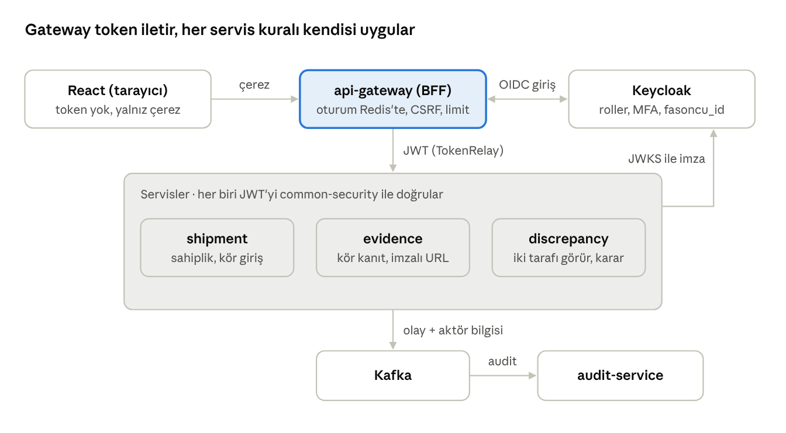

# Yetkilendirme Teknik Analizi – İplik Sevkiyat Sistemi

Sürüm 1.1 · 20.10.2026 · Mehmet Çelek

Kaynak: İplik Sevkiyat Ön Analiz Raporu v1.1 (Bölüm 6, 7, 11, 13, 14, 16) ve Java Mikroservis Mimarisi v1.

Değişiklik (1.1): Açık kararlar Y1–Y8 karara bağlandı, büyüme için Y9 (çok tesis / çok firma) eklendi.

## Özet

Kimlik doğrulamayı **Keycloak (OpenID Connect)** yapar, her mikroservis gelen **JWT erişim token'ını** kendisi doğrular. Yetkilendirme üç katmanlıdır: rol → izin (ön analiz 6.2 yetki matrisi), veri seviyesi kurallar ("kendi" sevkiyatı, kör giriş, kilit) ve audit.

| Karar | Seçim | Neden |
| --- | --- | --- |
| Kimlik sağlayıcı | Keycloak 26 (self-hosted, OIDC) | Açık kaynak, MFA (TOTP) hazır, kullanıcı/rol yönetim ekranı hazır |
| Token | JWT (RS256), erişim 5 dk, refresh 30 dk | Servisler merkeze sormadan doğrular; kısa ömür çalınma riskini düşürür |
| Frontend akışı | Gateway oturumu (BFF), Authorization Code + PKCE gateway'de | Token tarayıcıya hiç inmez, XSS ile çalınamaz; gateway ve Redis mimaride zaten var |
| Rol modeli | 6 rol (Keycloak realm rolü) → kodda izin seti | Matris tek yerde, test edilebilir; Keycloak'ta yalnız rol atanır |
| Veri yetkisi | Token'daki `subcontractor_id`, `driver_id` + servis içi politika sınıfları | "Kendi sevkiyatı" ve kör giriş rolle çözülemez, veriye bakmak gerekir |
| MFA | Admin ve Kalite için zorunlu, `acr`/`amr` claim ile servis tarafında da denetlenir | Ön analiz Bölüm 14 |
| Kod | Ortak `libs/common-security` kütüphanesi; kod kuralları onaylanınca yazılacak | Her mikroservis aynı kuralı tek bağımlılıkla alır |

## Kimlik doğrulama

Keycloak seçildi; kendi yazacağımız bir JWT servisi yerine hazır bir kimlik sağlayıcı kullanılması, MFA, parola politikası, oturum yönetimi ve hesap kilitleme gibi işleri sıfırdan yazmaktan kurtarır.

| Seçenek | Artı | Eksi | Sonuç |
| --- | --- | --- | --- |
| Keycloak (OIDC) | MFA, parola politikası, brute-force koruması, admin konsolu, LDAP/AD bağlanabilir | Ayrı bir sunucu ve PostgreSQL şeması işletilir | **Seçildi** |
| Kendi auth-service + JWT | Tam kontrol, ek sunucu yok | MFA, parola sıfırlama, kilitleme, token yenileme hep elle yazılır; güvenlik hatası riski yüksek | Elendi |
| Bulut IdP (Auth0, Entra ID) | Bakım yok | Kullanıcı başı ücret, veri yurt dışında (KVKK) | Elendi |

**Akışlar**

- **React uygulaması (BFF deseni):** Girişi Spring Cloud Gateway yönetir (`oauth2Login`, confidential client `iplik-gateway`, Authorization Code + PKCE). Token'lar gateway'in Redis'teki oturumunda durur; tarayıcı yalnız `HttpOnly`, `Secure`, `SameSite=Lax` oturum çerezi taşır. Gateway her API isteğine erişim token'ını ekler (`TokenRelay`). Durum değiştiren isteklerde CSRF token'ı (`X-XSRF-TOKEN`) zorunludur. React tarafında token kodu yazılmaz; `/oauth2/authorization/keycloak` ile giriş, `/logout` ile çıkış, `/api/v1/me` ile kullanıcı ve izin listesi alınır.
- **Mikroservisler:** OAuth2 Resource Server. Keycloak'ın JWKS adresinden imza anahtarını alıp her isteği yerelde doğrular, issuer ve audience (`iplik-api`) kontrol edilir.
- **Servisten servise çağrı:** Kullanıcı adına ise token aynen iletilir (token relay); zamanlanmış iş veya sistem işi ise Client Credentials ile alınan servis token'ı (`SYSTEM` rolü) kullanılır.

**MFA ve oturum**

- Admin ve Kalite rollerine Keycloak'ta TOTP (Google Authenticator vb.) zorunlu kılınır. Servis tarafı da token'daki `amr` içinde `otp` ya da `acr` = `2` görmezse bu rollerin izinlerini vermez; Keycloak ayarı yanlışlıkla kapatılsa bile koruma sürer.
- Ortak hesap yok: her depo personeli, şoför ve fasoncu yetkilisi kişisel hesapla girer (ön analiz Bölüm 14).
- Parola politikası: en az 10 karakter, 5 hatalı denemede 15 dk kilit (Keycloak brute-force detection).
- Şoför ve fasoncu için telefonda uzun oturum gerekiyorsa refresh token süresi bu client'ta 8 saate çıkarılabilir; erişim token'ı yine 5 dk kalır.

## Rol ve izin modeli

Keycloak'ta yalnızca 6 rol tutulur; kod bu rolleri aşağıdaki izinlere çevirir ve endpoint'ler rol değil izin ister. Böylece matris değiştiğinde tek bir sınıf (`RolePermissionMatrix`) değişir, controller'lara dokunulmaz.

Roller: `ADMIN`, `WAREHOUSE` (depo), `DRIVER` (şoför), `SUBCONTRACTOR` (fasoncu), `QUALITY` (kalite), `MANAGER` (yönetici) (+ yalnız servis token'larında `SYSTEM`).

Rol, izin ve claim adları koddaki adlarla aynıdır ve İngilizcedir (kod standartları NAME kuralları); ekranda Türkçe karşılıkları gösterilir. Kaynak: `libs/common-security` içindeki `Role`, `Permission`, `RolePermissionMatrix` ve `TokenClaims`. `/api/v1/me` cevabındaki `permissions[]` bu izin adlarını taşır.

✓ = izin var · kendi = yalnız kendisine ait sevkiyatlarda · sonra = kör giriş nedeniyle yalnız karşılaştırma bittikten sonra · boş = yok

| İzin | Admin | Depo | Şoför | Fasoncu | Kalite | Yönetici |
| --- | --- | --- | --- | --- | --- | --- |
| `MASTER_DATA_VIEW` | ✓ | ✓ |  |  | ✓ | ✓ |
| `MASTER_DATA_MANAGE` (fasoncu, şoför, araç, ürün) | ✓ |  |  |  |  |  |
| `USER_MANAGE`, `SETTINGS_MANAGE` (tolerans, zorunlu kanıt) | ✓ |  |  |  |  |  |
| `LOT_QUALITY_LOCK` | ✓ |  |  |  | ✓ |  |
| `SHIPMENT_VIEW` | ✓ | ✓ | kendi | kendi | ✓ | ✓ |
| `SHIPMENT_CREATE` (çuval atama, şoför/araç atama) | ✓ | ✓ |  |  |  |  |
| `SHIPMENT_CANCEL` | ✓ |  |  |  |  |  |
| `DISPATCH_RECORD` (çıkış kilosu, mühür no) |  | ✓ |  |  |  |  |
| `DISPATCH_VIEW` | ✓ | ✓ | yalnız çuval sayısı + mühür no | sonra | ✓ | ✓ |
| `DRIVER_DECLARATION_RECORD` |  |  | kendi |  |  |  |
| `DRIVER_DECLARATION_VIEW` | ✓ | ✓ | kendi |  | ✓ | ✓ |
| `DELIVERY_RECORD` (teslim kilosu, çuval listesi) |  |  |  | kendi |  |  |
| `DELIVERY_VIEW` | ✓ | sonra |  | kendi | ✓ | ✓ |
| `EVIDENCE_UPLOAD_DISPATCH` / `_DRIVER` / `_DELIVERY` / `_CLAIM` (aşamaya göre) |  | çıkış | kendi | teslim | itiraz |  |
| `EVIDENCE_VIEW` | ✓ | çıkış; teslim sonra | kendi | teslim; çıkış sonra | ✓ | ✓ |
| `EVIDENCE_INVALIDATE` | ✓ |  |  |  |  |  |
| `CORRECTION_CREATE` (gerekçeli düzeltme kaydı) | ✓ |  |  |  |  |  |
| `QUALITY_CLAIM_OPEN` | ✓ |  |  | kendi | ✓ |  |
| `DISCREPANCY_VIEW` | ✓ |  |  | kendi | ✓ | ✓ |
| `DISCREPANCY_RESOLVE` | ✓ |  |  |  | ✓ |  |
| `AUDIT_VIEW`, `REPORT_VIEW` | ✓ |  |  |  | ✓ | ✓ |

**Matristen farklılaşan veya eklenen noktalar** (son bölümde karara bağlandı):

- `LOT_QUALITY_LOCK` matriste yoktu; ön analiz Bölüm 10'daki "kalite parti bazında belirlenir ve kilitlenir" kuralı için Kalite ve Admin'e eklendi.
- `SHIPMENT_CREATE` Admin'e de verildi, çünkü süreç tablosunda (7.1, adım 1) sorumlu "Depo / Admin".
- Kanıt görüntüleme kör girişe bağlandı: çıkış kantar fotoğrafı kiloyu gösterdiği için fasoncu onu karşılaştırmadan önce göremez; depo da teslim kantar fotoğrafını göremez.
- Yönetici hiçbir yazma izni almaz; kodda bunu doğrulayan bir test olacak. Şoför çıkış kilosunu görmez, yalnız çuval sayısı ve mühür numarasını görür (Y1).

## Veri seviyesi kurallar

Rolün izni olması yetmez; her istekte sevkiyatın kime ait olduğuna ve hangi durumda olduğuna da bakılır. Sahiplik ve lokasyon kapsamı `common-security` içindeki `ScopeGuard` ile, kör giriş ve durum kuralları sevkiyat servisindeki erişim politikasıyla uygulanır; ikisi de hem endpoint'te hem de dönen veride çalışır.

**1. Sahiplik ("kendi")**

- Token'da `driver_id` ve `subcontractor_id` claim'leri bulunur (Keycloak kullanıcı özniteliğinden mapper ile). Bir fasoncu firmasının birden çok kullanıcısı aynı `subcontractor_id`'yi taşır.
- Şoför yalnızca `shipment.driverId = token.driver_id` olan, fasoncu yalnızca `shipment.subcontractorId = token.subcontractor_id` olan sevkiyatı görür.
- Liste sorguları bu filtreyi veritabanı sorgusuna ekler; sonradan bellekte eleme yapılmaz. Aynı filtre token'daki `site_ids` claim'iyle tesis kapsamını da uygular (Y9).
- Başkasının sevkiyatı istenirse **403** (`code: OUT_OF_SCOPE`) döner ve audit'e yazılır (kod standartları SEC-03). Sevkiyat kimlikleri UUIDv7 olduğu için tahminle varlık yoklama pratik değildir; liste uçları zaten yalnızca kapsamdaki kayıtları döner.

**2. Kör giriş**

- Karşılaştırma bitene kadar (durum `INCELEMEDE` veya `TAMAMLANDI` olana kadar) fasoncuya dönen sevkiyat verisinde çıkış brüt/dara/net kilo, çıkış mühür no, beklenen çuval sayısı ve Unique Key listesi **hiç yer almaz** (alan null değil, JSON'da yok). Aynı kural depo için teslim alanlarına uygulanır.
- Kör alan bir yan kanaldan sızmamalı: çıkış kantar fotoğrafı, filigranlı görüntü, PDF dışa aktarımı ve bildirim metinleri de aynı politikadan geçer.
- Rastgele fiziki kontrol seçimi (ön analiz 13.1) şoför ve fasoncuya sevkiyat `YOLDA` olana kadar gösterilmez.

**3. Duruma bağlı yazma ve kilit**

| İşlem | Kim | Hangi durumda |
| --- | --- | --- |
| Çuval atama, çıkış tartımı, mühür | Depo | `TASLAK` |
| Yükü teslim alma beyanı | Şoför (kendi) | `YUKLENDI` |
| Varış ve teslim beyanı | Şoför (kendi) | `YOLDA` |
| Kör teslim girişi ve teslim kanıtları | Fasoncu (kendi) | `TESLIM_BEKLIYOR` |
| Kalite itirazı | Fasoncu (kendi), Kalite, Admin | `KONTROLDE`, `INCELEMEDE`, `TAMAMLANDI` (teslimden sonra 3 iş günü) |
| İptal | Admin, gerekçeli | `TASLAK`, `YUKLENDI` |
| Düzeltme kaydı | Admin, gerekçeli | `IPTAL` hariç her durumda |

- Bir taraf girişini gönderdikten sonra o alanlar kilitlenir; aynı kişi bile tekrar değiştiremez. Değişiklik yalnız Admin'in gerekçeli düzeltme kaydıyla olur, eski değer silinmez ve kayıt audit log'a düşer.
- Bu tablo kodda `DurumKurallari` sınıfındadır. Durum geçişlerinin kendisi sevkiyat servisinin işidir; yetki kodu yalnız "bu durumda bu işe izin var mı" sorusunu cevaplar.

## Mikroservis mimarisinde yerleşim

Gateway kimliği doğrular ve token'ı iletir; her servis token'ı yeniden doğrular ve izin ile veri kuralını kendi içinde uygular (sıfır güven). Bu, Java mikroservis mimarisi v1 dokümanındaki gateway + 8 servis + Kafka yapısına oturur.

Tarayıcı token görmez; gateway token'ı ekler, servisler imzayı Keycloak anahtarıyla kendileri doğrular ve izin kararlarını kendi verisine bakarak verir.

| Bileşen | Yetkilendirmedeki görevi |
| --- | --- |
| Keycloak | Kullanıcı, parola, MFA, 6 realm rolü, `subcontractor_id` / `driver_id` öznitelikleri; JWT üretir |
| api-gateway | Giriş (BFF oturumu Redis'te), CSRF, kullanıcı başı hız sınırı, `TokenRelay`; iznin kendisine karar vermez |
| `libs/common-security` | Her servisin eklediği ortak kütüphane: JWT doğrulama, rol → izin matrisi, MFA kuralı, sahiplik/kör giriş/durum politikası, audit yayınlayıcı, 401/403 cevapları |
| shipment-service | Sevkiyat sahipliği, kör giriş, durum kilidi ve düzeltme kaydının asıl uygulandığı yer |
| evidence-service | Kanıt görüntüleme aynı kör giriş kuralına tabi; imzalı indirme adresi yalnız görme yetkisi olana üretilir |
| discrepancy-service | İki tarafı yan yana gören tek servis; uyuşmazlık kararı `DISCREPANCY_RESOLVE` ister |
| audit-service | Kafka'dan gelen audit olaylarını yalnız-ekle tabloya hash zinciriyle yazar |

**Servisler arası kurallar**

- Kullanıcı adına yapılan REST çağrısı aynı token'ı taşır; karşı servis kendi kuralını uygular. Böylece "servis A üzerinden dolanarak" kapalı veriye erişilemez.
- Kullanıcısız işler (karar sonrası kilit, zamanlanmış kontroller) Keycloak'tan client credentials ile `SYSTEM` rolünde token alır. `SYSTEM` her servis için ayrı client'tadır; hangi servisin çağırdığı audit'te görünür.
- Kafka olayları token taşımaz. Olay başlığında `aktorId`, `aktorRolleri`, `korelasyonId` bulunur; tüketici yetkiyi yeniden sorgulamaz, üretici servisin kararına güvenir. Bu yüzden olayı yalnız yetki kontrolünden geçmiş komut yayınlayabilir.
- Kör alanlar olaylara da sızmamalı: çıkış kilosunu taşıyan olayı notification-service fasoncuya giden bildirim metnine koymaz.
- Servisler yalnız iç ağda dinler; dışarı açık tek uç gateway'dir. Yine de servisler token'ı doğrulamadan hiçbir isteği kabul etmez.
- `/api/v1/me` ucu (gateway veya küçük bir user uçu) kullanıcının rol ve izin listesini döner. React menü ve butonları buna göre gizler; bu yalnız görünüş içindir, asıl kontrol backend'dedir.

## Audit ve KVKK

Her yetki kararı ve her kritik yazma işlemi, kim / ne / ne zaman / hangi cihaz bilgisiyle audit olayı olarak yayınlanır; olayların saklanacağı yer veritabanı thread'indeki karara bırakıldı.

- **Kaydedilenler:** reddedilen erişim (401/403), giriş ve MFA olayları (Keycloak event listener), düzeltme kayıtları, iptal, uyuşmazlık kararı, kanıt geçersiz işaretleme, rol değişikliği.
- **Alanlar:** kullanıcı id (`sub`), roller, işlem, kaynak (sevkiyat no), sonuç, sunucu zamanı, IP, User-Agent, `X-Device-Id` başlığı, istek korelasyon id.
- **Değişmezlik:** audit tablosuna uygulama kullanıcısının yalnız INSERT yetkisi olur; kayıtlar zincirleme hash ile bağlanır (her kayıt öncekinin hash'ini taşır), sonradan silme veya değiştirme tespit edilir.
- **Kodda:** `AuditYayinlayici` arayüzü. Şimdilik log'a yazan uygulaması var; Kafka/RabbitMQ veya doğrudan tablo kararı verilince tek sınıf eklenir.
- **KVKK:** konum ve cihaz bilgisi yalnız açık rıza verilmişse tutulur (token'da `kvkk_konum_rizasi`). Kişisel veriyi (telefon, TC no) görme `USER_MANAGE` iznine bağlıdır; diğer rollere maskeli döner. Log'lara token, parola ve kişisel veri yazılmaz.

## Uygulama planı

Kod, Java 25 kod kuralları dokümanı onaylandıktan sonra yazılacak. Kuralların uygulanabilir olduğunu görmek için küçük bir prototip denendi ve durduruldu; nihai kod değildir, kod kurallarına göre yeniden yazılacak.

**Prototipte doğrulananlar** (Spring Boot 4.1, Spring Security 7; prototip repoya eklenmedi):

- Rol → izin matrisi tek sınıfta tutulabiliyor; "Yönetici hiç yazma izni almaz", "kararı yalnız Admin ve Kalite verir" gibi kurallar birim testiyle korunabiliyor.
- Fasoncuya dönen cevapta çıkış kilosu karşılaştırma bitene kadar JSON'da hiç yer almıyor; teslimden sonra iki taraf da görünüyor.
- MFA'sız Admin token'ı düzeltme yapamıyor (403); iç ve dış rolü birleşik hesap reddediliyor (401); başka fasoncunun sevkiyatı 403 dönüyor; tamamlanmış sevkiyata teslim girişi 409 dönüyor.
- Birim testleri 39/39, uçtan uca güvenlik testleri 15/16 geçti. Kalan 1 test, birleşik rol hatasının 401 yerine istisna olarak yayılmasıydı; gerçek kodda dönüştürücünün `OAuth2AuthenticationException` fırlatması gerektiği not edildi.

**Yazılacaklar (sıra mimari dokümanındaki Faz 1 adım 1 ile aynı)**

1. Keycloak realm dışa aktarımı (`deploy/keycloak/iplik-realm.json`): 6 rol, `iplik-gateway` confidential client, servis başına client credentials client'ı, `subcontractor_id` / `driver_id` öznitelik mapper'ları, `iplik-api` audience mapper'ı, `amr` mapper'ı, Admin ve Kalite için koşullu OTP akışı, parola politikası ve brute-force koruması.
2. `libs/common-security`: matris, JWT dönüştürücü, politika sınıfları, audit yayınlayıcı, ortak güvenlik zinciri ve test yardımcıları (sahte Keycloak token'ı).
3. api-gateway güvenliği: `oauth2Login`, Redis oturumu, `TokenRelay`, CSRF, `/api/v1/me`.
4. Her servis için: endpoint başına izin, sorgularda sahiplik filtresi, cevapta kör alan kırpma ve bunların testleri.
5. Ortak yetki testi: matristeki her satır için "izinli rol 2xx, diğerleri 403" testi, CI'da zorunlu.

## Kararlar

Tüm maddeler 20.10.2026'da **karar verildi**. Proje sahibi seçimi büyümeye uygun olacak şekilde analize bıraktı; Y1 açıkça onaylandı. Amaç, bugün tek fabrikayla sade başlayıp yarın çok tesis ve çok firmaya kod yeniden yazılmadan geçebilmek.

| # | Konu | Karar | Neden |
| --- | --- | --- | --- |
| Y1 | Şoför çıkış kilosunu görsün mü? | **Görmez.** Yalnız çuval sayısı ve mühür no görür | Şoför kiloyu fasoncuya söylerse kör giriş boşa çıkar |
| Y2 | Admin sevkiyat oluşturabilir mi? | **Evet** | Süreç tablosu adım 1 |
| Y3 | Parti kalitesini kim belirler ve kilitler? | **Kalite ve Admin** | Bölüm 10 |
| Y4 | Kullanıcıları kim açar? | **Faz 1:** Admin, Keycloak konsolundan. **Faz 2:** master-data ekranından Keycloak Admin API ile. Fasoncu firmaları Keycloak **Organizations** olarak tanımlanır; `subcontractor_id` organizasyon üyeliğinden gelir | Yeni firma eklemek kod değişikliği gerektirmez; firma kendi kullanıcılarını ileride kendisi yönetebilir |
| Y5 | MFA kimde? | **Admin, Kalite zorunlu; Depo için açık bırakılabilir ayar.** Şoför ve fasoncuda yok | Liste ayar dosyasında (`yarnshipment.security.mfa-required-roles`), kod değişmeden genişler |
| Y6 | Şoför ve fasoncu oturum süresi | **8 saat oturum, 5 dk erişim token'ı** | Vardiya boyu tek giriş |
| Y7 | Yüksek tutarlı kalite kararı | **Kalite karar verir, eşik üstünde Admin ikinci onay verir.** Eşik tutarı Admin ayarıdır (başlangıç değeri pilotta belirlenir) | İki adımlı onay genel bir "onay adımı" olarak tasarlanır, başka kararlara da uygulanabilir |
| Y8 | Active Directory | **Varsa Keycloak'a LDAP olarak bağlanır; yoksa Keycloak'ın kendi kullanıcıları** | Uygulama kodu iki durumda da aynı kalır |
| Y9 | Çok tesis ve çok firma büyümesi | **Tek Keycloak realm'i; her kayıtta ve token'da `site_id` hazır.** Token `site_ids` claim'i taşır (Keycloak grubu), sahiplik filtresi fasoncu/şoför yanında tesis kapsamını da uygular. Bugün tek tesis olduğu için claim tek değer taşır | Yeni fabrika veya depo eklemek veri taşımadan ve kod değişmeden olur; ayrı şirket gerekirse ileride ayrı realm aynı kodla çalışır |

**Büyümeye hazırlık için tasarım kuralları**

- Endpoint'ler rol değil izin ister; yeni rol eklemek (ör. Planlama, Muhasebe) yalnız matrise satır eklemektir.
- Rol → izin matrisi Faz 1'de kodda tutulur. Rol sayısı artarsa veya müşteri bazında farklılaşırsa matris Keycloak "client role"lerine taşınır; uygulama kodu değişmez, çünkü izin adları aynı kalır.
- Veri kuralları tek bir politika katmanında toplanır ve sorgu kapsamı nesnesiyle veritabanına iner. Tesis, bölge veya firma gibi yeni bir kapsam bu nesneye alan eklenerek gelir.
- Servisler arası olaylar aktör ve tesis bilgisini taşır; raporlama ve audit ileride tesis bazında bölünebilir.
- Keycloak, OIDC standardı dışında özel bir özelliğiyle kodun içine girmez; gerekirse başka bir OIDC sağlayıcıya geçmek yalnız claim eşlemesini değiştirir.
